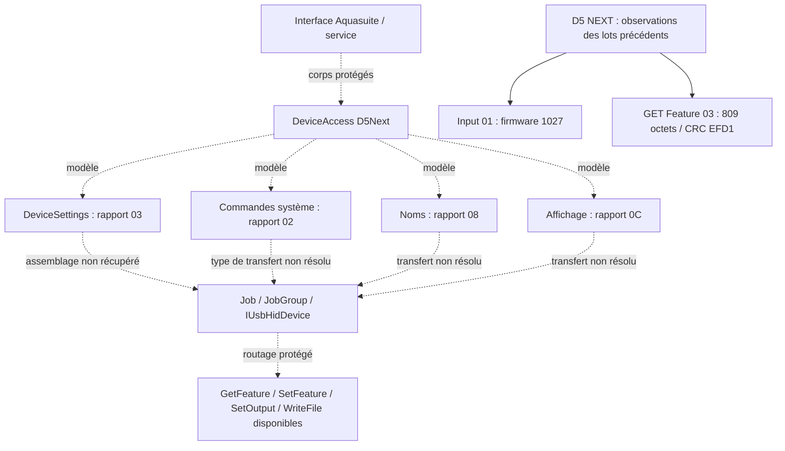

# D5 NEXT — Lot 3 : analyse statique d’Aquasuite

Date : 10 novembre 2026. Branche : `feat/d5next`.

**Résultat : PARTIAL.** Aquasuite X.94 déclare explicitement le couple firmware
**1027 / structure 3**. Ses métadonnées permettent de retrouver une structure de
806 octets et les offsets RGB du rapport HID de 809 octets. Les profils ajoutés
pendant l’analyse corroborent cette correspondance avec des données enregistrées
par Aquasuite. Le transport effectif de la commande système `0x02`, les effets
annexes du changement de mode et la persistance restent indéterminés.

**Aucune écriture n’est approuvée par ce rapport.** Aucun accès USB/HID, lancement
d’Aquasuite, Wine, modification du contrôleur, des outils ou des tests n’a eu lieu.
Les observations matérielles citées proviennent exclusivement des lots précédents.

## 1. Périmètre, méthode et conservation des données

Le répertoire détecté est `aquasuite/`. Inventaire PE, imports/exports, versions,
tables de métadonnées CLR, signatures, constantes, attributs de marshalling,
références CIL et décompilation ciblée ont été examinés. Les bases SQLite ont été
ouvertes avec `mode=ro&immutable=1`. Les XML, profils et le minidump fournis ont
été analysés comme des fichiers, sans charger leurs composants dans un processus
Windows ni exécuter leurs initialiseurs.

Outils locaux : Python avec pefile, dnfile, dncil, capstone et minidump ;
ILSpyCmd 9.1.0.7988 exécuté sous le runtime **Linux** .NET 8.0.34. Ces outils et
leurs résultats sont dans `.build/d5next-aquasuite/`, répertoire privé ignoré par
Git. L’exécution du décompilateur Linux ne constitue pas une exécution des
assemblies Windows analysées. Aucun code propriétaire n’a été incorporé au C++.

Les inventaires complets et index restent locaux : `inventory.json`,
`*.index.json`, `layout.json`, `profile-rgb-summary.json`,
`dump-method-coverage.json`, `crc-delta-check.json`. Aucun dump brut de la pompe,
profil complet, contenu de licence, numéro de série, identité Windows ou chemin
personnel n’est reproduit ici. Les fichiers tiers fournis restent à leur place.

Niveaux de preuve employés : **métadonnée** = déclaration présente dans le binaire ;
**fichier utilisateur** = état enregistré, sans preuve de son actualité ;
**déduction** = calcul ou association explicités ; **observation antérieure** =
lecture HID déjà rapportée. Aucun de ces niveaux ne représente une transaction
USB observée pendant ce lot.

## 2. Inventaire et dépendances

Inventaire initial : **299 fichiers, 111 972 519 octets**, dont **124 PE :
110 managés et 14 natifs**. Cela comprend 8 EXE, 115 DLL, 1 SYS, 6 JSON,
4 XML, 1 base SQLite et des ressources graphiques/audio/pages/archives.

L’utilisateur a ensuite ajouté **40 fichiers**, sans remplacer ni supprimer les
299 fichiers initiaux : total **339 fichiers, 130 587 903 octets**. Aucun nouveau
PE n’a été ajouté. Cet apport est examiné en section 7.

| Composant sous `aquasuite/` | Nature / version de fichier | Rôle identifiable statiquement |
|---|---|---|
| `aquasuite.exe` / `aquasuite.dll` | Apphost natif x64 / assembly ; 10.94.9644.16902 | Interface graphique et copie des classes DeviceAccess, dont D5 NEXT |
| `AquaComputerService.exe` / `.dll` | Apphost x64 / assembly ; 10.94.9644.16908 | Service ; son code ne constitue pas à lui seul tout le protocole |
| `AquaComputerServiceHelper.exe` / `.dll` | Apphost x64 / assembly ; 10.94.9644.16902 | Assistant de service, intégrations et supervision |
| `AquaComputerServiceLib.dll` | Assembly ; 10.94.9644.16901 ; 8 159 584 octets | Modèles D5 NEXT, structures, abstraction HID/WinUSB, commandes système |
| `AquaComputerCmd.exe` | Assembly ; 10.94.9644.16901 | Outil de commande avec ses propres imports HID |
| `DesktopNotifier.exe` | Assembly ; 1.0.0.0 | Notifications |
| `VisionNote.exe` | Assembly ; 10.94.9644.16900 | Composant Vision |
| `Content/AquaGpuTest/AquaGpuTest.exe` | Natif ; 1.0.0.0 | Composant de test graphique |
| `uninstaller.exe` | Natif | Désinstallation |
| `AquaComputerMonitoringDriver.sys` | Pilote natif x64 ; 2.2.0.11 | Supervision ; aucune chaîne D5 NEXT démontrée |
| `runtimes/win-{x64,x86}/native/RgbPxLib.dll` | Natif ; 1.1.0.0 | Exports de traitement RGBpx ; liaison avec chaque mode D5 non établie |
| `runtimes/win-{x64,x86}/native/{e_sqlite3,libSkiaSharp,sni}.dll` | Natif | SQLite, rendu graphique et dépendance SqlClient |
| `Content/aquasuite_db.database` | SQLite, 4 321 280 octets | Traductions, descriptions et paquets de firmware notamment |

Les trois paires `.deps.json` / `.runtimeconfig.json` décrivent respectivement
103 bibliothèques pour l’interface, 73 pour le service et 74 pour l’assistant.
Les runtimeconfigs demandent `Microsoft.NETCore.App` et
`Microsoft.WindowsDesktop.App` **8.0.0** : le runtime Windows complet n’est pas
embarqué. Les PE managés principaux ont un en-tête PE32 ; cela ne prouve pas
qu’ils exigent un processus Windows x86.

Le contrôle des assets déclarés relève 40 / 21 / 17 chemins absents. Il s’agit
principalement de variantes Android/Linux/macOS, de variantes Windows ARM/ARM64,
de fichiers PDB Skia et d’une variante navigateur SQLite. Les bibliothèques
natives Windows x64/x86 concernées sont présentes ; ces comptes ne signifient
pas autant de dépendances nécessaires manquantes. Les DLL système Windows,
le framework Desktop et les éventuelles conditions d’installation n’ont pas été
validés par exécution.

Les XML initiaux sont `aquasuite.VisualElementsManifest.xml` et, dans `Content/`,
`aquaducteco_curves.xml`, `aquastream_curves.xml`, `mps_data.xml`. Ils ne fournissent
pas de layout RGB D5 NEXT. La configuration utilisateur ajoutée est traitée
séparément, sans publier ses réglages hydrauliques.

### Empreintes permettant de retrouver les références

Les tokens ci-dessous désignent **cette version** de `AquaComputerServiceLib.dll`,
MVID `96743023-5358-4849-8fbd-2bfe7da0d896`. Ils ne sont pas des identifiants stables
entre versions. Le MVID de `aquasuite.dll` est
`7df5d20a-1643-45a5-a5d6-293c329bb816`.

| Fichier | SHA-256 |
|---|---|
| `AquaComputerServiceLib.dll` | `7b7a8f6262d4e6520ee0cc86797b1bdf59f4aab635c08f6322ce4e6c1727d4ed` |
| `aquasuite.dll` | `33d85512947b0ae41394d9ae7cc51ef21c2af233bc04dec0d32e144b17899fba` |
| `Content/aquasuite_db.database` | `445624ee86df05c6e503d687192a630b1f40070d980a1e8dcee63a21f03c95ed` |
| `runtimes/win-x64/native/RgbPxLib.dll` | `8eeb38777bfe6b47659d7adb2009068d6dd7ed65bf8d93d8dd73667e58deb9c8` |

## 3. Limite majeure : corps de méthodes protégés

Les cinq assemblies principales ont été indexées, y compris leurs imports
natifs et références CIL. `AquaComputerServiceLib.dll` contient 483 méthodes de
types D5 NEXT et `aquasuite.dll` en contient 1 716, classes d’interface comprises.
Les méthodes décisives examinées ont des corps de substitution de quelques
octets. Par exemple, les deux `DeviceSettings.WriteData` et le setter `mode`
n’ont que 4 octets de CIL ; leur décompilation apparente ne réalise aucune
écriture. **Ce résultat n’est pas leur implémentation effective à l’exécution.**

Leurs initialiseurs renvoient vers le mécanisme de protection
`rbbMfLmHxZxFPFOIyMul.YlyABTmHDo85EwfW40mV.Jw7mltVMige`,
méthode `0x060044B2`, RVA `0x66A4C`. Ce corps visible lit notamment la ressource
`eiS2jRq5HBlLcWgKO2.TtcX9a1JkhUQ56dShs` de 3 134 377 octets et contient
la logique d’installation d’un hook JIT et de protection mémoire. Les corps
originaux pertinents n’ont pas été restaurés dans cette analyse statique.

Conséquences : ne pas interpréter les `return true`, `return null` ou corps vides
affichés par le décompilateur comme la politique firmware, la séquence USB ou
l’absence d’écriture d’Aquasuite. Les signatures et constantes restent
exploitables ; les préconditions, arrondis, masques et ordonnancement cachés
restent ouverts. L’indexation n’a signalé aucune erreur de parsing des corps,
mais dnfile a émis un avertissement de taille de flux ; cela ne constitue pas
une certification exhaustive du code protégé.

## 4. Fonctions USB/HID localisées et chaîne d’échanges

| Référence dans `AquaComputerServiceLib.dll` | Token méthode | Élément vérifiable |
|---|---|---|
| Import `RupS9CUMqv` | `0x06000C3A` | `hid.dll!HidD_GetFeature` |
| Import `CxwSgkl7Rv` | `0x06000C3F` | `hid.dll!HidD_SetFeature` |
| Import `cneSNkek84` | `0x06000C41` | `hid.dll!HidD_SetOutputReport` |
| Import `NqiSLo2CJn` | `0x06000C31` | `kernel32.dll!WriteFile` |
| `IUsbHidDevice.SendOutputReport` | `0x06000CA4` | API abstraite Output |
| `IUsbHidDevice.SetFeatureReport` | `0x06000CA5` | API abstraite Feature en écriture |
| `IUsbHidDevice.GetFeatureReport` | `0x06000CA6` | API abstraite Feature en lecture |
| `IUsbHidDevice.InputReportRead` | `0x06000CA7` | API abstraite Input |
| `D5Next.GetUsb` / `SetDeviceAccess` / `AddJob` | `0x0600234C` / `0x0600234E` / `0x0600234F` | Rattachement USB et tâches ; corps protégés |
| `D5Next.GetDeviceInfo` / `get_Firmware` | `0x0600235A` / `0x06002358` | Extraction des informations ; corps protégés |
| `DeviceSettings.WriteData(byte[], int)` / `WriteData(bool)` | `0x06002436` / `0x06002437` | Paramètre de délai déclaré 150 ms / forceWrite ; corps protégés |
| `D5Next.SaveSettings` | `0x06002359` | Sauvegarde explicite ; corps protégé |

Les trois imports HID existent aussi dans `aquasuite.dll` aux tokens
`0x060004ED`, `0x060004F2`, `0x060004F4`, et dans `AquaComputerCmd.exe` aux tokens
`0x0600012C`, `0x06000131`, `0x06000133`. Les appels directs CIL à ces imports
n’ont pas été retrouvés dans les cinq assemblies indexées. Avec la protection
et les proxys, cette absence ne démontre ni leur inutilisation ni leur usage D5.

`DeviceIoControl` n’a pas été trouvé dans leurs déclarations P/Invoke. Une
recherche binaire du nom dans tous les EXE/DLL/SYS le retrouve seulement dans
`runtimes/win/lib/net8.0/System.Data.SqlClient.dll` ; ce résultat n’établit aucun
appel HID D5 NEXT. Une résolution dynamique ou l’usage interne d’un IOCTL par
Windows ne sont pas exclus par cette recherche.

L’abstraction `Job` (`0x02000109`) porte ID, direction, type de rapport, données
et délai ; `JobGroup` (`0x0200010E`) porte regroupement, fin et abandon sur erreur.
La présence d’un regroupement n’établit pas une transaction atomique D5.

La constante `DeviceInfoTools.VID_AQUACOMPUTER`, champ `0x04000B50`, vaut
`0x0C70`. `DeviceInformation` porte VendorId, ProductId et InterfaceIdetifier.
Le PID `0xF00E` n’a pas été retrouvé dans la table des constantes du cœur ;
la sélection effective PID/interface par la fabrique est protégée. L’identité
`0C70:F00E`, interface 1, reste une **observation antérieure**, corroborée par
aquapx, sans prétendre avoir décompilé le filtre officiel complet.



Les pointillés représentent des associations ou chemins incomplets ; aucun
SET montré par cette architecture n’a été observé ni envoyé pendant ce lot.

### Rapports recherchés

| ID | Descripteur antérieurement lu, ID compris | Correspondance statique et limite |
|---|---|---|
| `01` | Input, 162 octets | Structures d’en-tête de 32 / 15 octets ; firmware BE aux offsets 13–14. Ce sont des en-têtes, pas tout le rapport capteurs |
| `02` | **Output**, 11 octets | `SYSTEMCOMMAND_REPORTID=2`, commande `SettingsSave=2` ; type de transfert officiel non récupéré |
| `03` | Feature, 809 octets | `DeviceSettings.REPORT_ID=3`, structure de 806 octets, cohérente avec ID + structure + CRC |
| `08` | Feature, 773 octets | Classe de noms `jnwKkutgvhk8d1dnB8s.XwLteutSERbndPgcCdv`, type `0x020003D1`, `REPORT_ID=8` ; structure 770 octets : version + 32 noms de 24 octets, puis framing supposé |
| `0C` | Feature, 1 025 octets | Classe `QocQM8tkisPL766dDpw.iF4vJnt7185Y4DT4wGd`, type `0x020003CF`, champ `0x04002001 DISPLAY_REPORTID=12`, propriété `D5Next.display` ; pas une preuve de commande RGB directe |

La bibliothèque expose aussi WinUSB. `RgbPxLib.dll` x64 exporte
`RgbPxController` (RVA `0x12C0`), `Test1` (`0x1190`), `Test2` (`0x1270`) ; ses
imports natifs ne contiennent pas d’API USB/HID. L’interface graphique déclare
`RgbPxController` aux tokens `0x06009B5D` et `0x06009B5E`. Aucun chemin D5
démontré ne relie ces exports à un transfert séparé des six LED intégrées.
L’hypothèse d’un canal direct RGB sur IF0 reste non démontrée ; elle ne doit pas
devenir une implémentation ou une procédure d’essai.

## 5. Rapport 0x02 : commande de sauvegarde et ambiguïté du transport

La classe de commandes système est
`oPSQymH1LnNtqPymlcl.hVSCDhHqjdAwOK5Eh1m`, type `0x02000416`.
Le champ `0x040021D7` déclare `SYSTEMCOMMAND_REPORTID=2`. Son enum imbriqué,
type `0x02000417`, déclare notamment `Reset=1`, **`SettingsSave=2`**
(champ `0x040021DB`), `FactoryDefaults=3`, `Load=4`, `FlowCalibration=9`,
`EnableOutput=10`, `DisableOutput=11`, `UsbReset=523`.

Il s’agit donc d’un mécanisme générique de commandes système, comprenant une
commande de sauvegarde, et non d’un ID réservé exclusivement à la sauvegarde.
La méthode de construction de tâche `AMZHEvYoet(long,long)`, `0x0600256B`,
RVA `0x20200`, est protégée. Le corps `SaveSettings`, son timer et les événements
`SettingsWritten` / `SettingsSaved` ne révèlent pas l’ordonnancement effectif.

aquapx décrit et envoie par `SendFeatureReport` le paquet de 11 octets
`02 00 00 00 02 00 00 00 00 34 C6`. Son interprétation comme ID 2, commande
32 bits BE 2, argument nul et CRC est cohérente avec les noms et valeurs
retrouvés ; le packing et la couverture du CRC officiels ne sont pas prouvés
par le corps protégé. Hors ligne, le CRC-16/USB sur les huit octets entre ID et
CRC donne effectivement `0x34C6`.

Le descripteur observé annonce **Output**. Le code Go local choisit **Feature**.
Aquasuite dispose des deux API et de `WriteFile`, mais la chaîne effective D5
n’a pas été reconstruite. Selon Microsoft, [HidD_SetFeature envoie un rapport
Feature](https://learn.microsoft.com/en-us/windows-hardware/drivers/ddi/hidsdi/nf-hidsdi-hidd_setfeature),
alors que [HidD_SetOutputReport envoie un rapport
Output](https://learn.microsoft.com/en-us/windows-hardware/drivers/ddi/hidsdi/nf-hidsdi-hidd_setoutputreport).
Leur présence ne résout pas le choix effectué pour cette commande.

**Conclusion : rôle de sauvegarde corroboré ; ambiguïté Feature/Output non
résolue.** Aucun essai de `02`, changement d’API ou rejeu n’est justifié par ce
rapport. L’absence de commande SettingsSave ne démontre pas que l’écriture
de `03` serait volatile ou sans effet sur la mémoire non volatile.

## 6. Firmware 1027 et reconstruction du layout

### Déclarations explicites et firmware embarqué

`AquaComputer.DeviceAccess.Devices.D5Next.D5Next`, type `0x020003C9`, déclare
`VALID_FIRMWARE=1027` (champ `0x04001FBD`) et `VALID_STRUCTURE=3`
(`0x04001FBE`). La copie du type dans `aquasuite.dll` porte les mêmes valeurs.
`IsFirmwareValid`, `0x06002348`, RVA `0x1F448`, est protégé : aucune table
d’acceptation d’autres firmwares, adaptation ou migration de structure n’a été
prouvée. Une constante n’est pas la totalité de la politique d’exécution.

La table `firmware` de `Content/aquasuite_db.database` contient :

| Ligne | Device | Version | Bootloader | Hardware | Taille du conteneur |
|---|---|---|---|---|---|
| 17 | `d5next_EN` | 1027 | 100 | 1 | 147 096 octets |
| 18 | `d5next_DE` | 1027 | 100 | 1 | 147 364 octets |

Les conteneurs XML déclarent un segment à `0x4000`, avec données base64.
Le décodage du conteneur produit 110 096 / 110 296 octets opaques ; aucune
décompilation fiable du firmware ni interprétation de son algorithme de
persistance n’en a été tirée. Les deux bases utilisateur ajoutées contiennent
les mêmes paquets et empreintes : ce ne sont pas de nouvelles versions.

Le firmware **réel** 1027 reste celui lu antérieurement dans Input `01`, aux
offsets 13–14. La structure officielle d’information
`GCpelOtu3Kg4ZZT8DCd+vPSlpdm6fvOMKaEN0WLJ`, type `0x020003D6`, champ
`0x0400202B firmware`, confirme cette position et son encodage BE. USB
`bcdDevice` / `release_number`, taille et CRC ne sont pas utilisés comme preuve
d’identité firmware.

### Structure de configuration

Dans le namespace `DWD662tM7GQut1Qd5CR`, le type
`GCpelOtu3Kg4ZZT8DCd+WGhrJWm6x9Kts2rJW6Kc`, token `0x020003ED`, déclare
une disposition séquentielle, `Pack=1`, et des tableaux fixes avec leurs tailles.
Le calcul récursif des tailles donne **806 octets**. La règle d’alignement est
documentée par [Microsoft pour StructLayout.Pack](https://learn.microsoft.com/en-us/dotnet/api/system.runtime.interopservices.structlayoutattribute.pack?view=net-8.0).
Les attributs Endian indiquent BE pour les entiers concernés ; la routine
effective de sérialisation reste protégée. Les profils de la section 7 apportent
une corroboration indépendante sur des données enregistrées.

Les offsets suivants incluent l’ID HID en position 0 ; l’offset du corps est
donc inférieur de 1. Le framing déduit est `1 + 806 + 2 = 809`.

| Offsets HID | Taille | Champ déclaré / référence |
|---|---|---|
| 1–2 | 2 | `structure_id`, BE, champ `0x040020B2` ; valeur attendue 3 |
| 3–46 | 44 | Adresse aquabus, flags généraux, UI, chart, calibration/offsets capteurs |
| 47–55 | 9 | `fan` |
| 56–64 | 9 | `pump` |
| 65–149 | 85 | `controller_fan` |
| 150–236 | 87 | `controller_pump` |
| 237–239 | 3 | `strip_config`, champ `0x040020BE` |
| 240–799 | 560 | 8 contrôleurs LED de 70 octets, champ `0x040020BF` |
| 800–805 | 6 | `alarm` |
| 806 | 1 | `profileId` |
| 807–808 | 2 | CRC hors structure : concordance avec aquapx et les lectures antérieures |

Le modèle officiel contient bien les paramètres hydrauliques dans le même
ensemble. Il expose `_deviceSettings`, `_lastWriteBuffer` et des objets pompe,
ventilateur et courbes. Cela n’établit pas comment Aquasuite préserve leurs
octets lors d’une modification RGB : sa routine d’écriture reste cachée.
Notre copie fraîche et l’audit intégral sont donc toujours nécessaires.

### Champs RGB et limites du codec actuel

`strip_config` est le type `qf4aZ0m664M8XNZv5loi`, `0x020003E7` :
luminosité sur un octet (`0x04002095`) puis **flags sur deux octets BE**
(`0x04002096`). L’octet **239 est la partie basse des flags 238–239**.
L’interprétation « 239 = booléen indépendant » du prototype est simplifiée ;
les masques et leur inversion ne sont pas récupérés. La valeur Off `02` est une
observation attribuée à aquapx, pas la preuve que tous les autres bits sont libres.

Le contrôleur LED `NX5WrCm6WuVVlyJuwkP3`, type `0x020003EA`, fait 70 octets :

| Position dans l’enregistrement | Champ |
|---|---|
| +0 / +1 / +2 / +3 | strip / led_start / count / mode |
| +4–5 | flags BE |
| +6–9 | src |
| +10–15 / +16–21 | binding1 / binding2 |
| +22–45 | 12 valeurs de paramètres sur 16 bits |
| +46–69 | **6 entrées HSV de 4 octets** |

Pour l’index 6, base `240 + 6 × 70 = 660`, on retrouve le sélecteur
**663** et le premier HSV **706–709**. Les six entrées commencent à
706, 710, 714, 718, 722 et 726. Elles constituent une palette de paramètres ;
leur nombre ne prouve pas une correspondance « une entrée par LED physique ».

`DeviceInteropGlobal.HsvColor`, type `0x020003D3`, déclare `h` uint16 BE,
`s` octet, **`v` octet**, champs `0x04002017` à `0x04002019`.
Ainsi **709 contient une valeur HSV distincte de la luminosité générale 237**.
aquapx et notre codec D5 ne l’intègrent pas à leur état RGB et la préservent.
Les fichiers utilisateur montrent `v=255` pour ce groupe, mais cela ne remplace
pas une lecture fraîche de l’appareil avant une éventuelle opération.

La constante `MAX_HUE=1535` et les primaires Red=0, Green=512, Blue=1024
confirment la roue de **1536 valeurs**. Les valeurs approximatives 511 et 1023
de la documentation aquapx ne sont pas les constantes exactes officielles.
Les méthodes `AquaComputer.Container.HSVColor.FromRgb` (`0x06000DDE`) et
`HsvToRgb` (`0x06000DDF`) sont protégées : l’arrondi exact d’Aquasuite pour une
couleur quelconque reste inconnu.

L’enum `DeviceSettings+LedControllerSetup+LedMode`, type `0x02000413`, confirme
`FixedColor=1`, `Breathing=2`, `Rainbow=3`, champs `0x040021BB` à `0x040021BD`.
Son setter `set_mode`, `0x0600253A`, et `LockModeChangeReset` sont protégés.
L’existence du verrou de réinitialisation invite à vérifier les changements
annexes ; elle ne prouve pas quels octets Aquasuite modifie. Impossible de
conclure qu’un changement Rainbow → FixedColor ne touche que le sélecteur et
le premier HSV, ou qu’il exige de modifier les six entrées.

## 7. Apport des fichiers ajoutés pendant le lot

### Profils : preuve enregistrée du couple 1027 / structure 3

`aquasuite-data/Settings_DeviceProfiles.xml` déclare un appareil de type
`d5next` et quatre emplacements `profile1` à `profile4`. Chacun déclare
`firmware=1027`, `version=3` et contient 1 080 caractères base64 décodables en
**808 octets : corps de configuration 806 + CRC 2, sans ID HID**.
Il ne faut donc pas appliquer directement à ces fichiers les offsets HID.

Dans les quatre emplacements, le corps commence par `structure_id=3` BE.
Le CRC-16/USB sur les 806 octets du corps correspond aux deux derniers octets :
respectivement `E88D`, `E9CD`, `290C`, `EB4D`. Les emplacements ne diffèrent
que par `profileId` et le CRC : il s’agit de quatre variantes d’un même état,
pas de quatre essais matériels indépendants.

Résumé limité au RGB : luminosité générale 255, flags de strip `0000` ;
contrôleur index 6 : **strip 1, début 0, nombre 6, mode 3, flags `0000`** ;
ses six entrées HSV sont `(0,255,255)`. Cela corrobore fortement l’association
du bloc 660–729 au groupe de six LED et la présence du V à 709. Ce fichier
enregistré ne prouve pas l’état actuel ni la façon dont FixedColor consomme la
palette. Aucune configuration enregistrée n’a été envoyée ou préparée pour rejeu.

### Autres ajouts et minidump

| Apport | Résultat pertinent et limite |
|---|---|
| Bases `aquasuite-data/aquasuite_db.database` et `.backup` | Ouverture SQLite immutable ; mêmes paquets D5 EN/DE 1027 que la base initiale. Pas d’extraction des données personnelles ou historiques |
| `Log_Service.txt` | 914 lignes ; mentions D5 NEXT et 1027, aucun nom des API HID recherchées ni journal explicite de rapports `0x02` / `0x03`. Ce journal ne tranche pas le transport |
| XML utilisateur | Paramétrage du service, profils, interface, serveur, analyse vidéo et mises à jour ; pas de table publique d’offsets du protocole. Les réglages et identifiants personnels ne sont pas reproduits |
| Fichier `aquasuite service helper` | XML de tâche planifiée Windows, pas une nouvelle bibliothèque ; aucune tâche exécutée ou enregistrée |
| Pages `.page` et modèles | Présentation de télémétrie/tableaux de bord, dont `d5next.page` ; absence de preuve d’une transaction RGB à partir de ces fichiers |
| `aquasuite.license` | Inventorié uniquement ; contenu non exploité et non reproduit |
| Deux `.pf` | Signatures `MAM` de fichiers Prefetch compressés ; pas de décompression des chemins d’exécution. Aucun apport démontré au protocole HID |
| `Report.wer` | APPCRASH, version 10.94.9644.16902, exception `e0434352`. Aucune conclusion sur la pompe ou une opération USB |
| `aquasuite.exe.23540.dmp` | Minidump de 7 510 360 octets analysé statiquement ; limites détaillées ci-dessous |

Le minidump contient 14 entrées de répertoire, une liste de modules et
14 358 fragments mémoire ; **pas de Memory64ListStream**. Les flags de l’en-tête,
lus directement comme uint64, valent `0x200121` ; le bit FullMemory `0x2`
est absent. Interprétation fondée sur les structures et types de minidump
[documentés par Microsoft](https://learn.microsoft.com/en-us/windows/win32/api/minidumpapiset/ne-minidumpapiset-minidump_type).
Le parseur Python décalait l’affichage des champs temporels/flags ; le résultat
a été contrôlé directement sur l’en-tête binaire, sans s’appuyer sur cet affichage.

Le module `aquasuite.dll` du dump a la même taille d’image et le même timestamp
PE que le fichier analysé. Le module `AquaComputerServiceLib.dll` n’apparaît
pas dans sa liste de modules. Une recherche de couverture mémoire aux RVA des
**38 méthodes** du type D5Next de l’interface et des deux `WriteData` n’a rendu
disponible aucune fenêtre complète de 20 octets. Aucun corps utile protégé ou
chaînage d’appel HID n’a donc été récupéré de ce dump. Cela ne démontre pas que
tout son contenu serait inutilisable avec d’autres techniques ; ce n’est pas
un dump mémoire complet du service ni une capture USB.

## 8. Matrice Aquasuite / aquapx / C++ / matériel

| Point | Aquasuite statique / fichiers | aquapx local | Prototype C++ | Matériel, lots précédents | Conclusion |
|---|---|---|---|---|---|
| Identité | VID 0C70 ; modèle D5 ; filtre PID/IF protégé | 0C70:F00E, premier HID énuméré | Filtre explicite VID/PID/IF1 | 0C70:F00E IF1 | Identité concrète connue ; filtre officiel incomplet |
| Firmware/layout | Constantes 1027/3 ; profils 1027/3 cohérents | Pas de matrice firmware démontrée | Écriture refusée pour tout firmware réel | Input01 : 1027 | Correspondance 1027/3 fortement corroborée ; pas d’approbation d’écriture |
| Taille/CRC03 | Corps 806 ; profils 808 sans ID, CRC corrects | 809, CRC-16/USB BE | Même framing et CRC | GET03 809, EFD1 | Concordant ; routine CRC officielle non récupérée |
| Static/Breathing/Rainbow | Enum 1/2/3 | 1/2/3 | 1/2/3 | Rainbow 3 confirmé visuellement | Enum confirmé ; Static/Breathing pas essayés ici |
| Teinte | 0–1535 ; primaires 0/512/1024 | Roue 1536 ; doc primaire approximative | Roue 1536 | Hue 0 dans Rainbow | Échelle concordante, arrondi officiel inconnu |
| Luminosité | Master237 + V709 distinct | Modèle simplifié V=master | Même simplification, V709 préservé | Master255 ; V709 non résumé | Complément nécessaire avant garantie de rendu |
| Activation | Flags16 BE238–239 | Octet239 traité 0/2 | Même simplification | Octet239=0 | Masque officiel non résolu |
| Six LED | Profils : groupe6 strip1/count6 | Offsets663/706 | Groupe uniforme supposé | Six LED uniformes non testées | Mapping renforcé ; sémantique palette/Static ouverte |
| Conservation hydraulique | Champs dans le même corps ; écriture cachée | Copie puis patch | Copie fraîche, masque et audit intégral | Aucun SET réel | Protection C++ vérifiable, pratique officielle non prouvée |
| Sauvegarde02 | SYSTEMCOMMAND2, SettingsSave2 ; transport caché | SendFeatureReport02 | Aucune sauvegarde | Descripteur Output02 | Divergence non résolue |
| Persistance sans02 | Politique effective cachée | NoSave décrit comme non persistant | Aucune garantie revendiquée | Aucun test d’écriture/persistance | Reste inconnue |
| RGB séparé | RGBpx/WinUSB présents, chemin D5 non démontré | IF0 évoquée comme hypothèse | Aucun chemin séparé | Aucun transfert direct observé | Ne pas implémenter sur cette seule base |

Sources C++ examinées : `D5NextProtocol.{h,cpp}`,
`AquaComputerD5NextController{,Detect}.cpp`, outils `D5NextDiagnostic`,
`D5NextReadOnly` et `D5NextPinkTest`. Sources Go :
`aquapx-main/re/PROTOCOL.md`, `internal/aqua/d5next.go`, `lighting.go`.
Ces fichiers ont été lus et conservés sans modification.

## 9. Vérification du candidat rose #FF69B4

Le codec actuel calcule H=1408 (`0580`), S=150 (`96`), V=255 pour
RGB `(255,105,180)` : teinte 330°, saturation 150/255. Cette valeur de H est
cohérente avec la roue officielle de 1536 pas. L’arrondi identique par Aquasuite
n’est pas démontré. Le mode FixedColor officiel vaut bien 1.

Différentiel **historique**, fondé sur la lecture précédente EFD1 :

| Offset HID | Avant | Candidat | Interprétation affinée |
|---|---|---|---|
| 237 | FF | FF | Master inchangé |
| 238–239 | Non intégralement résumé | Inchangés | Flags16 ; aucune normalisation |
| 663 | 03 | 01 | Mode du groupe6 |
| 706 | 00 | 05 | H, octet fort |
| 707 | 00 | 80 | H, octet faible |
| 708 | FF | 96 | S du premier HSV |
| **709** | **Non résumé dans la lecture réelle** | **Préservé** | V distinct ; vaut FF dans les profils enregistrés seulement |
| 710–729 | Non résumés | Préservés | Autres entrées de palette |
| 807 | EF | F8 | CRC, octet fort |
| 808 | D1 | 60 | CRC, octet faible |

Les **six différences** annoncées sont donc toujours cohérentes :
`663,706,707,708,807,808` ; 803 octets restent identiques. Une vérification
indépendante du CRC par linéarité, à partir du CRC initial et des quatre
différences de données connues, redonne **F860**, sans posséder, recréer ou
rejouer la configuration brute. Ce CRC ne sera pas réutilisable automatiquement
sur une autre lecture fraîche.

Ce candidat ne change aucun octet hydraulique selon le layout reconstruit.
Il reste **non validé pour une écriture** : V709 actuel non vérifié, palette et
réinitialisation de mode non résolues, rendu six LED non observé, conservation
de certains paramètres d’animation potentiellement pertinente et persistance
inconnue. Les profils renforcent le contexte sans constituer une baseline live.
Il ne faut ni étendre le masque à 709 ou à toute la palette ni approuver 1027
automatiquement à partir de cette analyse.

## 10. Détection OpenRGB et recommandations

Le détecteur existant utilise `REGISTER_HID_DETECTOR_I` pour 0C70:F00E/IF1,
sous `OPENRGB_D5NEXT_OFFLINE_TESTS` ou `OPENRGB_D5NEXT_READ_ONLY_DETECTION`.
L’enregistrement reste désactivé dans une compilation normale. Rien n’a été
activé, compilé ou lancé pendant ce lot. L’initialisation de l’adaptateur en
lecture seule ne doit pas être remplacée par celle du logiciel officiel.

La branche de détection réelle Linux exige `R_OK|W_OK`, car hidapi ouvre en
lecture/écriture. Les permissions antérieurement constatées `0440 root:plugdev`
permettent l’outil O_RDONLY à un membre du groupe mais ne satisfont pas ce
précontrôle hidapi. Cette analyse ne change ni permissions ni règles udev, et
ne démontre pas l’acceptation finale par « Scan Devices ».

Avant tout premier SET, dans un lot distinct explicitement autorisé :

1. Faire revoir la correspondance 1027/structure3 à partir de ces preuves.
   Compléter le contrôle de structure, aujourd’hui absent de `ValidateReport` :
   version passive réelle, `structure_id` BE1–2, taille, ID et CRC, avec refus
   des combinaisons inconnues. Ne pas lever le blocage firmware actuel ici.
2. Dans une future lecture seule autorisée, relever uniquement les métadonnées
   nécessaires : structure_id, flags238–239, groupe6 strip/start/count/mode/flags,
   les HSV pertinents dont V709. Vérifier que l’état frais correspond aux
   préconditions ; ne pas déduire celles-ci des profils ajoutés.
3. Établir quels paramètres FixedColor consomme et ce que le setter de mode
   réinitialise, par une preuve statique supplémentaire ou une capture existante
   attribuée au bon firmware. Toute nouvelle manipulation par Aquasuite ou
   capture provoquant un changement matériel exige une autorisation distincte.
4. Pour résoudre 02, retrouver le routage original ou examiner une capture USB
   existante montrant type de SET_REPORT et interface. Ne pas « essayer les deux
   API ». Son usage reste exclu de notre test et de la découverte.
5. Maintenir accès exclusif, configuration fraîche, transaction sérialisée,
   copie intégrale, masque minimal revu et audit de chaque différence avant
   un unique SET03 éventuellement autorisé. Aucun rejeu de profil, restauration
   automatique, save02, Output, reset, boucle ni répétition après erreur.
6. Garder l’incertitude de persistance explicite. Aquasuite fonctionne avec cette
   pompe selon l’utilisateur, mais son retour à Rainbow peut sauvegarder des
   réglages ; cela ne constitue pas une récupération garantie sans persistance.
   Reprendre la surveillance et la procédure d’arrêt du rapport de préparation
   rose avant une autorisation matérielle séparée.

## 11. Git, attribution et vérifications

Les répertoires `aquasuite/` et `aquapx-main/` ne contiennent aucun fichier indexé
dans Git. Ils restent **non suivis et non ignorés**, donc susceptibles d’être
ajoutés par un futur `git add .`. Exclusion locale non versionnée proposée pour
`.git/info/exclude` :

```gitignore
/aquasuite/
/aquapx-main/
```

Cette proposition n’a pas été appliquée ; aucun ajout à l’index n’a été effectué.
`.build/` est déjà ignoré. Les profils, licence, dump de processus, rapport WER,
Prefetch, sources décompilées et paquets de firmware doivent rester locaux.

Le travail de reverse engineering des offsets/captures est attribué à
[hirparak/aquapx](https://github.com/hirparak/aquapx) et aux contributeurs ayant
fourni les captures de [l’issue OpenRGB 2111](https://gitlab.com/CalcProgrammer1/OpenRGB/-/issues/2111).
Le codec C++, ses protections et sa validation sont le travail des contributeurs
OpenRGB, documenté dans [le rapport du lot 1](AquaComputerD5Next.md).
Les noms, constantes et layouts relevés ici proviennent du logiciel propriétaire
Aqua Computer pour une étude d’interopérabilité ; aucune fonction décompilée,
ressource ou implémentation propriétaire n’est reproduite dans le contrôleur.
Ce travail ayant consulté les sources tierces, aucune indépendance « clean room »
n’est revendiquée.

Vérifications hors matériel : calcul des layouts à partir des tables CLR,
comparaison aux déclarations décompilées, quatre validations CRC de profils,
contrôle affine du CRC rose et CRC du paquet système documenté, couverture
mémoire du minidump et comparaison d’intégrité des fichiers sources/tiers.
Les ajouts de l’utilisateur ont leur propre inventaire et référence d’intégrité.
Aucun test C++ n’a été relancé : ni code ni politique d’écriture n’ont changé.
Aucun commit, push ou PR.

## Statut final : PARTIAL

**Confirmés dans les artefacts étudiés :** déclaration firmware1027/structure3,
layout de 806 octets, groupes de 70 octets, HSV complet avec V distinct, modes
1/2/3, commande SettingsSave2, profils enregistrés 1027/3 avec CRC valides et
groupe de six LED cohérent avec les offsets connus. Le candidat rose conserve
un différentiel et un CRC mathématiquement cohérents.

**Non résolus :** transport effectif de 02, chaîne d’appels cachée, état frais
des champs supplémentaires, effets annexes du changement de mode, palette
consommée par Static et persistance de 03. Ces limites empêchent de déclarer le
premier SET sûr. Les protections du prototype restent intactes. Campagne
arrêtée après analyse statique, sans opération matérielle.
