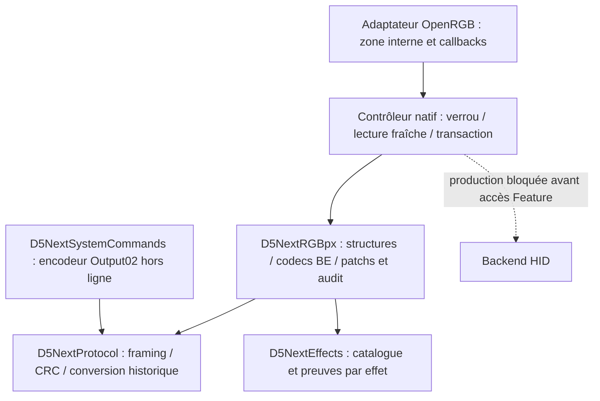

# D5 NEXT — lot 6 : fondation native RGBpx C++ sous Linux

Date : 10 novembre 2026, Europe/Paris. Branche `feat/d5next`.

**Refonte et tests hors ligne terminés, changements disponibles pour revue.**
Le codec représente les huit groupes complets, le catalogue distingue les
preuves par effet, et le moteur prépare des patchs minimaux sur une configuration
fournie par l’appelant. La connaissance du firmware 1027 / structure 3 est
distincte de l’autorisation d’écrire : **aucune écriture de production activée**.

Aucun périphérique USB/HID ouvert ou énuméré, aucune application OpenRGB ou
Aquasuite lancée, aucun essai matériel, save, reset, flashage, modification de
permissions, commit, push ou PR pendant ce lot. Les GET/SET des tests sont des
fonctions en mémoire ou des syscalls remplacés, sans backend matériel.

## 1. Audit avant modification

Le dépôt était propre sur `feat/d5next`, au commit
`35227a93bb5635b919fed026cefeceeef2e6df0d`,
`docs(d5next): document RGBpx effects and USB mappings`.
Les huit références demandées étaient présentes :

- [Prototype initial](AquaComputerD5Next.md).
- [Analyse statique Aquasuite](D5NextAquasuiteAnalysis.md).
- [Baseline Windows](D5NextWindowsBaseline.md).
- [Analyse RGB Windows](D5NextWindowsRGBAnalysis.md).
- [Moteur RGBpx, lot 4](D5NextRGBpxEngineAnalysis.md).
- [Corrélation vidéo/USB, lot 5](D5NextRGBpxVideoUSBMapping.md).
- [CSV des événements](D5NextRGBpxVideoUSBEvents.csv).
- [CSV des paramètres](D5NextRGBpxVideoUSBParameters.csv).

Les captures `d5next_baseline{,02,03,04,05}.pcapng` et la vidéo
`d5next test.mp4`, citées dans les rapports Windows, **ne sont pas présentes**
dans le répertoire du contrôleur de cet espace Linux. Leurs analyses et les
CSV constituent les références de ce lot ; aucune nouvelle analyse des fichiers
bruts ni nouvelle capture n’est revendiquée. `aquasuite/` et `aquapx-main/`
existent localement, sans modification ni nouvelle décompilation.

Le contrôleur, le détecteur, l’adaptateur et les outils existants ont été
examinés avec `RGBControllerInterface.h`, les mécanismes pertinents de
`RGBController.cpp`, `RGBController.h`, la documentation API et `CONTRIBUTING.md`.
Le dépôt emploie C++17, QMake et la séparation protocole/contrôleur/adaptateur.
`OpenRGB.pro` inclut récursivement les sources sous `Controllers/` : aucune
modification du projet principal ou de l’API partagée n’est nécessaire.

Écarts initiaux confirmés :

| Prototype | Preuve plus récente / traitement |
|---|---|
| Trois effets seulement | Catalogue de 24 valeurs, dont Unused et 23 effets ; aucun 06 |
| Pas de contrôle structure_id | Structure BE1–2=3 maintenant contrôlée, après taille/ID/CRC |
| Master utilisé comme V RGB combiné | Modèles séparés ; pas de substitution du master à V709 |
| Octet239 remplacé par 0/2 | Modification du bit0002, conservation des autres bits et de l’octet238 |
| Paramètres/source/bindings/palette absents du modèle | Huit enregistrements complets, avec valeurs et sources signées |
| Transition limitée au mode et au H/S | Refus explicite des transitions sans politique validée |
| Sauvegarde encore incertaine dans les anciens rapports | Encodeur **Output02** conforme aux preuves Windows ultérieures ; aucun transport ajouté |
| Un seul éclairage logique | Une zone fixe de six LED internes, sans capacité de couleur individuelle |
| Breathing annoncé avec une couleur | Retiré de la liste native réduite : rôle de palette non suffisamment établi |

Les documents historiques restent des instantanés de leurs lots ; leurs
incertitudes Output/Feature ou leurs anciens différentiels ne doivent pas
supplanter les preuves Windows et les restrictions de ce lot.

## 2. Architecture retenue



Le modèle RGB ne contient pas les paramètres hydrauliques ni un constructeur
de configuration complète. Le buffer original de 809 octets reste la source
des octets opaques. Les structures C++ ne sont jamais projetées sur ce buffer :
ni cast de structure, ni structure packée, ni lecture non alignée.

`D5NextRGBpx::Decode` exige une identité explicite : VID0C70/PIDF00E/IF1,
firmware1027, rapport03 de809 octets, CRC valide et structure3. Il restitue
les champs RGB sans normaliser les modes, flags ou teintes inconnus.
Cette identité décrit l’entrée et ne confère aucune permission matérielle.

`ReadBE16`, `ReadInt16`, `WriteBE16`, `WriteInt16` contrôlent les limites et les
valeurs avant accès. Le décodage signé soustrait65536 dans un entier lorsque le
bit de signe est présent ; il ne dépend pas d’un cast hors plage vers short.
Les plateformes avec octets8bits et short16bits sont vérifiées à la compilation.

`EncodeController` sérialise uniquement un enregistrement de70 octets, avec
validation des teintes. Il sert à la sérialisation et aux tests ; il n’insère
pas de groupe dans un rapport à envoyer et n’autorise aucune allocation.

Alternatives écartées : remplacer le rapport complet par une structure
réinitialisée ; reproduire les premières valeurs capturées comme presets ;
appliquer un mapping universel de values/flags ; exposer les23 effets comme
opérationnels ; créer un service externe ou une extension du protocole OpenRGB.

## 3. Nouvelles structures et correspondance binaire

| Structure C++ | Contenu et encodage |
|---|---|
| `D5NextIdentity` | VID, PID, interface et firmware fournis séparément de l’autorisation |
| `D5NextHSV` | Hue unsigned16 BE, saturation8, **value8 indépendante du master** |
| `D5NextBinding` | x1/x2 **signed16 BE**, y1/y2 unsigned8 |
| `D5NextRGBpxController` | Strip/start/count/mode, flags16, source signée, deux filtres, deux bindings, douze signed16, six HSV |
| `D5NextRGBpxConfiguration` | Structure, master, flags du strip et huit contrôleurs |
| `D5NextParameterInfo` | Index, fonction, preuve, échantillons signés observés, bornes connues ou inconnues, trame |
| `D5NextFlagInfo` | Masque et signification propres à un effet, trame de bascule isolée |
| `D5NextColorInfo` | Index, rôle, composantes éditables et niveau de preuve |
| `D5NextEffectInfo` | ID, nom, sélection capturée ou non, besoin de transport PC, listes de paramètres/flags/couleurs |
| `D5NextRGBpxPatch` | Une action demandée, groupe cible, mode attendu, champs de requête suffisamment larges pour contrôler les valeurs avant réduction |

Chaque groupe commence à `240 + index*70` : strip0, start1, count2, mode3,
flags4–5, source.id6–7, filtres8–9, bindings10–15/16–21,
values22–45, HSV46–69. Les **douze values sont des short signés**, et non des
uint16. Source et bornes x utilisent le même encodage signé explicite.

Dans le groupe6, mode663, flags664–665, values682–705 et HSV706–729.
Master237, flags strip238–239 et V709 sont séparés. La disposition de six
entrées HSV ne prouve pas une association individuelle aux six LED.

CRC03 : CRC-16/USB sur1–806, stockage BE807–808. L’encodeur SettingsSave produit
les11 octets `02 00 00 00 02 00 00 00 00 34 C6`, avec CRC sur1–8.
Le transport documenté est SET_REPORT **Output**, EP0/IF1, wValue0202.
La classe de commandes système n’a **aucune fonction d’envoi** et aucun encodeur
de reset ou flashage. Aucune sauvegarde n’est appelée par le contrôleur.

## 4. Catalogue et preuves Windows

`D5NextEffects` contient les24 valeurs de l’enum X.94. `captured` signifie une
présence/sélection du **groupe6 dans le CSV du lot5**, pas une certification
d’autonomie, de rendu ou d’aptitude à être exposé dans l’interface native.
Unused est déclaré et présent ailleurs dans les profils, mais n’est pas Off.

Dans le tableau, vN=values[N], **I**=variation isolée, **C**=seulement compatible,
**D**=déclaré, **O**=configuration observée. Toutes les grandeurs numériques
ci-dessous sont signed16 ; **aucune borne UI complète ni unité physique n’est
annoncée**. Les champs minimum/maximum du catalogue sont inactifs lorsque
`range_known=false`, ce qui est actuellement le cas de tous ces paramètres.

| ID / effet | Niveau | Paramètres nommés par les preuves | Flags confirmés pour cet effet |
|---|---|---|---|
| 00 Unused | D | Aucun | Aucun ; pas une commande Off |
| 01 FixedColor | O | Aucun values attribué ; HSV0 couleur principale dans les captures antérieures | Aucun |
| 02 Breathing | I | v0 Speed ; v1 Intensity ; v2 Delay max. brightness ; v3 Delay min. brightness | Aucun |
| 03 Rainbow | I/C | v0 Speed **C** ; v1 Color range **I** | 0002 Reverse direction |
| 04 Blink1 | I | v0 Speed ; HSV0.H/S Background | 0002 Fade in ; 0004 Fade out ; 0008 Random color ; 0010 Slide colors |
| 05 Blink2 | I | v0 Speed | 0004 Fade ; 0008 Random color ; 0010 Slide colors |
| 07 Sequential | I | v0 Speed ; v1 Smoothness ; v3 Delay after sequence ; v4 Delay before sequence | 0002 Reverse direction ; 0004 Fade ; 0008 Random color |
| 08 Visor1 | I | v0 Speed ; v1 Smoothness ; v2 Width | 0002 Reverse direction ; 0008 Random color ; 0020 Color mode 2 ; 0040 Color change ; 0080 Circular |
| 09 Visor2 | I | v0 Speed ; v1 Smoothness ; v2 Width | Même liste que08, confirmée séparément |
| 0A Marquee1 | I | v0 Speed ; v1 Smoothness ; v2 Width | 0002 Reverse direction ; 0008 Random color ; 0080 Circular |
| 0B Marquee2 | I | v0 Speed ; v1 Smoothness ; **v4 Color change speed** | 0002 Reverse direction ; 0008 Random color |
| 0C Ambient | I | v0 Speed ; v1 Color range ; v2 Total area | Aucun ; pas assimilé à AMBIENTpx |
| 0D Bar1 | D | Source/paramètres non attribués | Aucun |
| 0E Candle | I | **v0 Intensity**, pas Speed | Aucun |
| 0F Rain1 | D | Inconnus | Aucun |
| 10 Rain2 | D | Inconnus | Aucun |
| 11 Rain3 | D | Inconnus | Aucun |
| 12 Switch | D | Source/seuils non attribués | Aucun |
| 13 RainbowShift | I | v0 Point speed ; v1 Point smoothness ; v2 Point size ; v3 Color change speed ; v4 Color range | Aucun |
| 14 Sound1 | D / PC | Transport audio non établi | Aucun |
| 15 Sound2 | D / PC | Transport audio non établi | Aucun |
| 16 Sound3 | D / PC | Transport audio non établi | Aucun |
| 17 Sound4 | D / PC | Transport audio non établi | Aucun |
| 18 AmbientPx | D / PC | Transport vidéo non établi | Aucun |

Pas de mode06, ni de nouveaux IDs déduits des traductions multi-appareils.
Le catalogue stocke **33 paramètres :32 I et1 C**, **26 associations effet/flag**,
et deux rôles de couleur, FixedColor.Color et Blink1.Background. Le CSV en
attribue60 au total ; le rôle FixedColor supplémentaire vient des captures
antérieures, pas d’une édition de couleur dans la vidéo05.

Les trames de référence sont attachées aux entrées numériques et aux flags.
Exemples : RainbowShift v0:5423, Breathing v1:9039,
Marquee2 v4:16409, Candle v0:26749 ; Reverse03:3999 et Fade in04:14253.
Les tests relisent les66 lignes du CSV et contrôlent noms, indices, masques,
preuves et échantillons, puis rejouent **chaque édition isolée sur un buffer
synthétique** avec vérification de tous les octets préservés.

## 5. Politique des patchs et transactions

`BuildPatch` refuse les identités/layouts inconnus, le groupe hors0–7 et tout
groupe autre que6. Le groupe6 doit rester strip1/start0/count6 et son mode doit
être celui attendu. Aucun champ d’allocation, source, filtre ou binding n’est
éditable par cette API. Ces champs sont néanmoins entièrement décodables.

Actions actuellement préparables, **sans autorisation matérielle** :

| Action | Restriction |
|---|---|
| Master | Valeur brute0–255 ; ne change ni V ni Off ; tests0/153/255 |
| Strip Off | Bit0002 uniquement ; préserve tous les autres bits des flags16 |
| Paramètre numérique | Mode inchangé, attribution I, valeur appartenant aux échantillons observés du contrôle |
| Flag d’effet | Un masque confirmé pour ce mode uniquement ; aucun écrasement des autres bits |
| Couleur | H/S de HSV0 en FixedColor ou Background de Blink1 ; autres rôles et V refusés |
| Mode | Sélection identique = inchangé ; toute transition vers un autre mode refusée |

Le choix d’autoriser **seulement les échantillons numériques observés** est une
politique conservatrice du préparateur, pas une affirmation que les autres
valeurs seraient invalides sur la pompe. Par exemple, RainbowShift.Point speed44
est préparable et45 est refusé faute de plage validée. Les bornes du stockage
signed16 ne deviennent pas des bornes UI. Rainbow.Speed reste C et n’est pas
éditable, même si son échantillon51 est connu.

Les modes non capturés, Unused, les effets PC, paramètres non attribués et
masques inconnus sont refusés. Le même bit0002 ne peut donc pas être présenté
comme Reverse pour Blink1, et les flags d’effet n’atteignent jamais238–239.

Construction : copie du buffer fourni, action ciblée, nouveau CRC, comparaison
des809 octets sous un masque de bits propre à l’action. `AuditPatch` reconstruit
le résultat attendu depuis l’original et la requête et compare le candidat
intégralement. Un candidat avec CRC correct et modification hors requête est
refusé. Une erreur laisse la sortie intacte ; les buffers chevauchants sont
testés. Aucun rapport ancien n’est conservé pour un futur rejeu.

Le contrôleur natif garde un mutex sur toute la transaction : lecture fraîche,
validation, patch(s) locaux et audit, un SET03 au maximum, ou aucun si inchangé.
Les erreurs de transfert bloquent les transferts suivants ; aucun retry, reset,
readback automatique, sauvegarde ou restauration n’est ajouté. Ce verrou ne
prouve toujours pas l’exclusivité contre un autre processus.

`SetLighting` n’utilise plus le constructeur historique. Il sépare master et
couleur, refuse les transitions et refuse une couleur dont V diffère du V frais,
puisque l’édition de V n’est pas encore autorisée par la politique de patch.
`ApplyRGBpxPatch` permet la même transaction pour une seule action explicite.
Dans les compilations normales, ces chemins restent bloqués **avant le GET**.

La façade historique `D5NextLighting`/`BuildLightingReport` reste pour les outils
et tests antérieurs : hypothèse de format explicite, sous-ensemble de trois
effets, pas une API d’approbation firmware ou de préparation matérielle. Elle
contrôle maintenant la structure, préserve les bits inconnus et refuse les
transitions. Le chemin natif utilise exclusivement le nouveau modèle avec
identité et garde d’autorisation. L’ancien plan rose Rainbow→Fixed et son audit
limité à six changements sont refusés ; `--write-once` est bloqué dans le CLI
rose **avant la découverte**. Le CRC historique F860 n’est pas un preset.

## 6. Intégration OpenRGB : réalisée et reportée

L’adaptateur conserve une seule zone, désormais linéaire et fixe à **six LED
internes**. Il ne crée ni90 LED supposées raccordées ni une zone pour le groupe7
Unused. Il n’annonce pas de couleur parLED, de Direct, de redimensionnement, de
sauvegarde ou de modes par zone.

La découverte expérimentale demeure désactivée par défaut et, lorsqu’elle est
compilée explicitement, construit toujours l’adaptateur **Read only**, sans
GET/SET d’initialisation. Dans la construction prototype hors découverte, la
liste réduite est Off/Static/Rainbow, avec `active_mode=-1` initialement pour ne
pas appliquer Off par défaut. Off est un pseudo-mode de l’adaptateur utilisant
le flag de strip ; il n’écrit jamais Unused dans le sélecteur du contrôleur.
Ces entrées restent expérimentales et ne lèvent aucune barrière matérielle.
Le retrait de Breathing change les indices de cette ancienne liste prototype ;
les profils expérimentaux antérieurs doivent être revus, pas migrés aveuglément.

| Interface existante | Décision et limite |
|---|---|
| Modes / palette standard | Static à une couleur ; aucun nombre de couleurs inventé pour les autres effets |
| Brightness | Master séparé du V ; portée physique exacte vis-à-vis des strips à vérifier avant support matériel étendu |
| Speed | Pas de borne inventée ni de conversion en ms/Hz ; plusieurs fonctions par effet empêchent un mapping universel |
| Direction | Les masques connus sont dans le catalogue ; pas de correspondance physique Left/Right inventée pour Reverse |
| Modes par zone | `zone.modes`, `active_mode`, Get/SetZoneMode* et `DeviceUpdateZoneMode` existent ; reportés jusqu’à validation de l’allocation et des recouvrements |
| Configuration spécifique | API JSON déjà présente ; pas d’extension réseau nécessaire. Édition UI/SDK propre au périphérique reportée |

L’étude de `GetDeviceSpecificConfigurationSchema`, Get/SetDeviceSpecificConfiguration
et de leurs variantes par zone montre que le schéma est extrait de la chaîne
`configuration`, avec clés `schema`, `configuration`, `zones`. Le setter de base
vérifie surtout la présence des clés, title et type ; **il n’est pas un validateur
complet des types, bornes et dépendances**. Il appelle le callback sous AccessMutex
et DeviceMutex : celui-ci devra parser directement l’état protégé et éviter de
rappeler un getter verrouillant le même mutex.

Pour le prochain lot, un schéma par effet pourra proposer les paramètres signés
et booléens confirmés, conserver `expected_mode` et déléguer à `BuildPatch`.
Il devra contrôler lui-même types, clés et dépendances, faire une seule transaction
par action et ne jamais transformer un chargement de profil en autorisation
d’écriture. Aucun schéma éditable ni faux état « lu depuis la pompe » n’est
exposé ici. Les setters et chargements de profil sont testés comme inertes en
production et pour la découverte Read only.

## 7. Tests et compilation effectués

Environnement : GCC13.3.0, C++17, QMake3.1 / Qt5.15.13. Les exécutables de tests
n’utilisent pas Qt, hidapi ou libusb. Les fixtures sont des motifs artificiels,
avec champs RGB explicitement choisis ; leurs valeurs hydrauliques n’ont aucun
sens matériel. Aucun rapport réel complet ou fichier Aquasuite n’est intégré.

Commandes exécutées depuis la racine, **avant les modifications** :

```sh
bash tests/AquaComputerD5Next/run.sh
bash tests/AquaComputerD5Next/run-readonly.sh
bash tests/AquaComputerD5Next/run-pink.sh
```

| Suite | Avant | Après |
|---|---:|---:|
| Codec historique / contrôleur / adaptateur / détecteur simulés | 44 218 | **45 033** |
| Diagnostic, syscalls remplacés | 8 264 | **8 264** |
| Rose, politique production | 281 759 | **274 269** |
| Rose, politique synthétique | 216 245 | **208 733** |
| Nouveau codec RGBpx / catalogue / CSV / patchs / Output02 | — | **742 189** |
| Construction sans macros de simulation ni découverte optionnelle | — | **158** |

Les anciens tests de « transition rose réussie » ont été remplacés par les
tests de refus et d’intégrité de sortie ; Breathing n’est plus annoncé dans
l’adaptateur. Les différences de comptes ne sont pas une mesure de couverture.

Commandes **après modifications**, toutes réussies :

```sh
bash tests/AquaComputerD5Next/run.sh
bash tests/AquaComputerD5Next/run-readonly.sh
bash tests/AquaComputerD5Next/run-pink.sh
bash tests/AquaComputerD5Next/run-rgbpx.sh
bash tests/AquaComputerD5Next/run-production.sh
bash tests/AquaComputerD5Next/run-rgbpx.sh --sanitize
bash tests/AquaComputerD5Next/run-readonly.sh --sanitize
bash tests/AquaComputerD5Next/run-pink.sh --sanitize
bash tests/AquaComputerD5Next/run.sh --sanitize-known-baseline
bash tools/AquaComputerD5Next/build.sh
bash tools/AquaComputerD5Next/build-pink.sh
```

ASan/UBSan RGBpx :742189 ; lecture seule :8264 ; rose :274300/208764.
Ces trois suites n’utilisent aucune suppression. La suite native complète utilise
**la suppression existante et annoncée** du diagnostic nonnull de
`RGBControllerInterface.h` documenté dans le lot1 ; ce résultat ne constitue
pas un passage sans suppression de cette API partagée. Aucun nouveau fichier
D5 n’est exclu des diagnostics. Les outils matériels ont été **compilés uniquement**.

Contrôles syntaxiques de production, réussis avec `-Werror` :

```sh
g++ -std=c++17 -Wall -Wextra -Wpedantic -Werror -fsyntax-only \
    -I. -IRGBController -Idependencies/json -Idependencies/CRCpp \
    -Idependencies/hidapi-win/include -Ihidapi_wrapper -Iserial_port \
    -Ii2c_smbus -ISPDAccessor -IControllers/AquaComputerD5NextController \
    Controllers/AquaComputerD5NextController/*.cpp
g++ -std=c++17 -Wall -Wextra -Wpedantic -Werror -fsyntax-only \
    -DOPENRGB_D5NEXT_READ_ONLY_DETECTION \
    -I. -IRGBController -Idependencies/json -Idependencies/hidapi-win/include \
    -Ihidapi_wrapper -Iserial_port -Ii2c_smbus -ISPDAccessor \
    -IControllers/AquaComputerD5NextController \
    Controllers/AquaComputerD5NextController/AquaComputerD5NextControllerDetect.cpp
```

Couverture nouvelle : les65536 encodages BE/signed16, offsets non alignés et
débordements de taille, deux bindings, douze valeurs et six HSV dans chacun des
huit groupes, teintes0/1535 et rejet1536, master0/153/255 distinct deV et Off,
flags contextualisés avec bits inconnus, toutes les éditions numériques/flags
isolées du CSV, patch d’un paramètre, sortie intacte sur erreur, recouvrement de
buffers, corruption de chaque octet du candidat même avec CRC recalculé,
refus de tous les65535 autres firmwares16bits, structure inconnue, identités et
groupes invalides, refus de transitions et encodage Output02 sans envoi.

Les tests natifs conservent les transferts courts/incertains, l’absence de retry,
les200 transactions de deux threads sans chevauchement, les lectures fraîches,
no-op et fermetures de handles. Le nouveau test de transaction applique une
édition RGBpx isolée et refuse un groupe externe et une structure inconnue.

Contrôle de frontière système et dépendances :

```sh
strace -f -e trace=%file,ioctl -o .build/d5next-lot6/production.trace \
    .build/d5next-tests-production/d5next-production-tests
strace -f -e trace=%file,ioctl -o .build/d5next-lot6/rgbpx.trace \
    .build/d5next-rgbpx/rgbpx-tests Documentation/D5NextRGBpxVideoUSBParameters.csv
ldd .build/d5next-tests-production/d5next-production-tests
ldd .build/d5next-rgbpx/rgbpx-tests
git diff --check
```

Les deux traces ne contiennent aucun accès hidraw/USB/sysfs de découverte ni
ioctl HID/USB. `ldd` ne montre aucun backend HID/USB ou Qt. Les journaux restent
sous `.build/d5next-lot6*`, ignorés. Aucun build/distribution de l’application
graphique complète ni build Windows/macOS n’est revendiqué.

## 8. Fichiers pour revue

| Périmètre | Fichiers |
|---|---|
| Nouveaux modèles/codecs | `Controllers/AquaComputerD5NextController/D5NextRGBpx.{h,cpp}` |
| Catalogue | `Controllers/AquaComputerD5NextController/D5NextEffects.cpp` |
| Commande système hors ligne | `Controllers/AquaComputerD5NextController/D5NextSystemCommands.{h,cpp}` |
| Protocole historique durci | `Controllers/AquaComputerD5NextController/D5NextProtocol.{h,cpp}` |
| Transactions natives | `Controllers/AquaComputerD5NextController/AquaComputerD5NextController.{h,cpp}` |
| Modèle OpenRGB | `Controllers/AquaComputerD5NextController/RGBController_AquaComputerD5Next.cpp` |
| Diagnostic et retrait du test rose | `tools/AquaComputerD5Next/D5NextDiagnostic.cpp`, `D5NextPinkMain.cpp`, `build.sh` |
| Tests adaptés | `tests/AquaComputerD5Next/D5NextTests.cpp`, `D5NextTests.pro`, `ReadOnlyTests.cpp`, `PinkTests.cpp` |
| Nouveaux tests | `tests/AquaComputerD5Next/RGBpxTests.cpp`, `ProductionTests.cpp`, `run-rgbpx.sh`, `run-production.sh` |
| Rapport | `Documentation/D5NextRGBpxCppRefactor.md` |

Le détecteur, les fichiers API partagés, les documents de preuve, les deux CSV
et les répertoires tiers ne sont pas modifiés. Aucun fichier n’a été ajouté à
l’index Git. Les tests n’exigent aucun appareil physiquement accessible.

## 9. Protections actives et prochain lot

En production : layout inconnu, firmware non établi et `write_authorized=false`.
Aucun setter d’autorisation, option force ou approbation par JSON n’est ajouté.
Seul le constructeur déjà réservé aux tests sans backend initialise une identité
synthétique1027 et l’autorisation de simulation ; ne pas utiliser cette macro
dans une application connectée au matériel. La politique de l’outil rose refuse
toujours tous les firmwares réels, indépendamment du nouveau refus de transition.
Construction, profil, scan et destruction n’envoient aucune commande de configuration.

Prêts pour revue et pour préparer une **future validation distinctement autorisée** :
framing/CRC, représentation complète, lecture des huit groupes, patch master/Off,
paramètres et flags isolés dans leur domaine observé, couleur H/S à mode établi,
audit intégral et simulation de transaction native. Cette préparation n’est pas
une déclaration de sûreté matérielle ni une autorisation de SET.

À reporter : politique de transition et mémoire par effet ; bornes et unités
UI ; édition V, palettes et compteurs de couleurs ; source/bindings ; intégration
JSON éditable et modes par zone ; portée physique de master/Off ; exclusivité
interprocessus ; validation firmware/état réellement lus avant toute autorisation ;
scan complet de l’application ; premiers essais RGB et critères d’arrêt.
Persistance de03 et récupération restent inconnues. Audio, vidéo, WinUSB,
allocation externe et sauvegardes automatiques ne sont pas implémentés.

Provenance : les faits initiaux de protocole restent attribués à
[hirparak/aquapx](https://github.com/hirparak/aquapx) et aux contributeurs de
[l’issue OpenRGB2111](https://gitlab.com/CalcProgrammer1/OpenRGB/-/issues/2111).
Les correspondances nouvelles proviennent des rapports et captures indépendantes
Windows fournis pour cette branche. Aucun code Go traduit, aucune fonction
Aquasuite décompilée ou ressource propriétaire n’est incorporé. CRC++ et JSON
sont des dépendances déjà présentes. Les changements restent locaux pour une
revue humaine conformément aux consignes de contribution OpenRGB ; aucune
soumission upstream ou acceptation par le projet n’est revendiquée.

**Arrêt à la fin de la refonte et des validations hors ligne. NO-GO matériel maintenu.**
