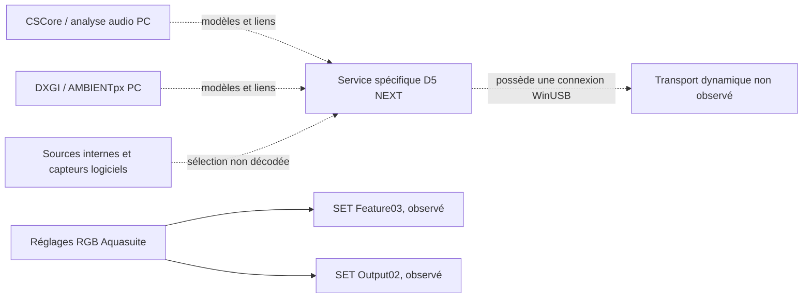

# D5 NEXT — lot 4 : cartographie du moteur RGBpx

Date : 10 novembre 2026, Europe/Paris. Branche `feat/d5next`.
Révision C++ examinée : `3f80b24c35829c52ecb993daa8dd62221ed1be09`.

**Complément ultérieur :** le [lot5 vidéo/USB](D5NextRGBpxVideoUSBMapping.md)
attribue plusieurs curseurs et masques d'options par variations isolées dans
la capture05. Les inconnues indiquées ici restent celles du périmètre du lot4 ;
consulter le complément pour les nouvelles preuves et leurs limites.

**Résultat : cartographie partielle, sans modification C++.** Le catalogue
spécifique D5 NEXT contient **24 valeurs d'effet**, et non seulement Static,
Breathing et Rainbow. La structure de 70 octets est décomposée jusqu'aux
bindings, à la source et aux douze valeurs. Les captures confirment les
transitions et les sauvegardes, mais pas encore le rôle de chaque réglage.
Le transport des effets audio/vidéo reste inconnu malgré des liens statiques
plus précis vers le service D5 NEXT et WinUSB.

À la demande de l'utilisateur, la refonte et les tests C++ sont reportés sous
Linux ; ce document constitue le dossier Windows préalable. Aucun accès à la
pompe, envoi USB/HID, lancement d'Aquasuite, capture audio/vidéo/écran, reset,
flashage, modification de fichier tiers, commit, push ou PR n'a été effectué.
Les méthodes protégées n'ont pas été restaurées ni interprétées comme leur
implémentation réelle. Aucun code propriétaire ou Go n'est reproduit.

## 1. Sources, méthode et niveaux de preuve

Sources effectivement disponibles et relues :

- `C:\Program Files\aquasuite\` : métadonnées de `AquaComputerServiceLib.dll`,
  `aquasuite.dll`, `AquaComputerServiceHelper.dll`, `AquaComputerService.dll`,
  `CSCore.dll` ; inventaire des ressources embarquées et fichiers Content.
- `Content/aquasuite_db.database` : tables de traductions lues comme des
  pages SQLite, sans exécution SQL ni chargement d'une bibliothèque Aquasuite.
- `C:\ProgramData\aquasuite-data\Settings_DeviceProfiles.xml` : quatre
  configurations sauvegardées ; éléments de structure de la configuration
  VideoAnalyzer. Aucun historique personnel ou contenu de licence exploité.
- Les quatre captures `d5next_baseline{,02,03,04}.pcapng`, conservées intactes
  sous `Controllers/AquaComputerD5NextController/`, hors Git.
- [Analyse statique précédente](D5NextAquasuiteAnalysis.md),
  [analyse USB initiale](D5NextWindowsBaseline.md),
  [chronologie RGB détaillée](D5NextWindowsRGBAnalysis.md),
  sources locales `RGBController/RGBController{,Interface}.h` et
  `RGBController/RGBController.cpp`.

| Source | SHA-256 |
|---|---|
| AquaComputerServiceLib.dll | `7b7a8f6262d4e6520ee0cc86797b1bdf59f4aab635c08f6322ce4e6c1727d4ed` |
| aquasuite.dll | `33d85512947b0ae41394d9ae7cc51ef21c2af233bc04dec0d32e144b17899fba` |
| AquaComputerServiceHelper.dll | `14bb3932ca8d8617c744cc5652b90196fb2d9ba927f3c2cecd0d03903bf054e9` |
| Content/aquasuite_db.database | `445624ee86df05c6e503d687192a630b1f40070d980a1e8dcee63a21f03c95ed` |
| Settings_DeviceProfiles.xml | `85b93d1c5c4f867d15dd45f3011c545af2a60045add4cb5172d8eecad3313397` |

Les empreintes des deux assemblies principales et de la base Content sont
identiques à celles du rapport précédent. Les tokens cités ci-dessous sont
propres à cette version. Sauf indication contraire, ils désignent ServiceLib.

Méthode : lecteurs locaux de tables PE/ECMA-335 et SQLite, TShark 4.6.9 en
lecture de fichiers, calculs CRC hors ligne. Les tailles de structures sont
recoupées par Pack=1, FieldMarshal, signatures et EndianAttribute. Aucun
initialiseur ou code de ces assemblies n'a été exécuté. Les index, outils
d'analyse et résumés restent privés dans `.build/d5next-engine/`, ignoré.

Niveaux de preuve : **M** = métadonnée du binaire ; **R** = ressource logicielle ;
**P** = profil sauvegardé ; **U** = échange USB ; **I** = inférence à vérifier.
Une déclaration ou traduction n'établit pas le support effectif par le firmware.

Les getters/setters importants de `LedControllerSetup`, `DataBinding`,
`ControllerViewModel`, ainsi que `WriteData`, ont des corps visibles de quatre
octets, déjà identifiés comme substituts protégés dans le rapport précédent.
Leur taille est une limite d'analyse, pas la preuve de leur comportement réel.
Les six ressources embarquées d'`aquasuite.dll` ont des noms obfusqués et des
contenus opaques dans la forme enregistrée ; aucune table de presets ni BAML
exploitable n'a été retrouvée par cette lecture. Aucun déchiffrement tenté.

## 2. Catalogue spécifique D5 NEXT

Source primaire : enum
`AquaComputer.DeviceAccess.Devices.D5Next.DeviceSettings+LedControllerSetup+LedMode`,
type **02000413** ; copie concordante dans `aquasuite.dll`, type **020003A7**.
La colonne de libellés anglais est un rapprochement **R**, par clé identique,
avec `lng_keyword`/`lng_texts`, anglais languageId=1, sous-groupe177 de la base
Content, groupe `farbwerk360`. Le sous-groupe D5 NEXT160 ne fournit ici que le
titre RGBpx. L'usage de ces traductions partagées par chaque vue D5 n'est pas
reconstruit : ce ne sont pas des libellés D5 observés à l'écran.

| ID hex / décimal | Nom enum M | Libellé correspondant R | Preuve USB et dépendance |
|---|---|---|---|
| 00 / 0 | Unused | Not assigned | Présent dans le groupe7, inactif selon le nom ; pas une commande Off |
| 01 / 1 | FixedColor | Single color | Changements groupe6 observés, sans flux PC RGB supplémentaire dans les fenêtres capturées |
| 02 / 2 | Breathing | Breathing | Déclaré, pas de SET observé |
| 03 / 3 | Rainbow | Rotating rainbow | Groupe6 capturé03/04 ; aussi présent dans le groupe0 |
| 04 / 4 | Blink1 | Blinking | État enregistré dans les groupes3–5 ; aucun changement isolé |
| 05 / 5 | Blink2 | Color change | Déclaré, pas observé |
| 07 / 7 | Sequential | Sequence | Déclaré, pas observé |
| 08 / 8 | Visor1 | Scanner | État du groupe1 ; aucun changement isolé |
| 09 / 9 | Visor2 | Laser | Déclaré, pas observé |
| 0A / 10 | Marquee1 | Wave | Déclaré, pas observé |
| 0B / 11 | Marquee2 | Color sequence | État du groupe2 ; aucun changement isolé |
| 0C / 12 | Ambient | Color shift | Déclaré ; ne pas le confondre avec AMBIENTpx ou automatiquement avec une capture d'écran |
| 0D / 13 | Bar1 | Bar graph | Ressource décrivant un contrôle par capteur ; source réelle non capturée |
| 0E / 14 | Candle | Flame | Déclaré, pas observé |
| 0F / 15 | Rain1 | Rain | Déclaré, pas observé |
| 10 / 16 | Rain2 | Snowfall | Déclaré, pas observé |
| 11 / 17 | Rain3 | Stardust | Déclaré, pas observé |
| 12 / 18 | Switch | Color switch | Ressource décrivant un contrôle par capteur ; source réelle non capturée |
| 13 / 19 | RainbowShift | Swiping rainbow | SET groupe6, capture02 trame4383 ; transition complète, fonction précise des paramètres non testée |
| 14 / 20 | Sound1 | Sound flash | Modèles et vue audio présents ; dépendance au PC probable, transport non observé |
| 15 / 21 | Sound2 | Sound bars | Idem ; contrôle de niveau évoqué par les ressources |
| 16 / 22 | Sound3 | Sound slider | Vue avec six sous-modes déclarés ; aucun SET de cet effet |
| 17 / 23 | Sound4 | Sound shift | Modèles et vue audio présents ; aucun SET de cet effet |
| 18 / 24 | AmbientPx | AMBIENTpx | Vue et analyseur d'image côté PC présents ; aucun SET/flux de cet effet |

**06 n'est pas déclaré.** Aucun ID supérieur à24 n'est déclaré dans cette enum.
La base partagée comporte aussi Time, Gradient, Highlight, Noise, Sound5,
Shutter et d'autres textes : leur présence dans une base multi-appareils ne
permet pas de les ajouter au catalogue firmware D5. Aucune nouvelle commande
n'est extrapolée à partir de ces noms.

Les effets01/03/13 sont configurés sans trafic Bulk dans les captures ; cela
corrobore une exécution embarquée après configuration, sans prouver leur
autonomie après fermeture d'Aquasuite ou déconnexion. Pour les autres effets,
la classe autonome/capteur/PC reste à confirmer. Les huit capteurs logiciels
déclarés constituent notamment un cas où une source peut dépendre du PC sans
que le calcul de l'effet soit effectué par le PC.

## 3. Structure de 70 octets, source, bindings et paramètres

`NX5WrCm6WuVVlyJuwkP3`, type **020003EA**, Pack=1 : 70 octets.
Le rapport 03 complet fait 809 octets, ID compris ; les huit enregistrements
commencent à `240 + 70 × index`. Le groupe6 commence donc à660.

**Précision par rapport à l'hypothèse «12 uint16» :** le champ `values`,
**040020A5**, est déclaré **Int16[12]**, et son attribut indique BigEndian.
La façade UI utilise des `int32`. Les valeurs positives capturées ne suffisent
pas à préciser les plages valides de chaque paramètre, mais les futurs lecteurs
doivent conserver le signe déclaré ; ne pas transformer ce tableau en uint16
sans justification indépendante.

| Offsets HID groupe6 | Champ M | Type et taille | Preuve et limite |
|---|---|---|---|
| 660 | strip | uint8 | Valeur1 pour le groupe des six LED U ; sens matériel corroboré, pas un numéro d'interface USB |
| 661 | led_start | uint8 | 0 U ; base d'indexation générale à confirmer |
| 662 | count | uint8 | 6 U |
| 663 | mode | uint8 | Enum ci-dessus ; 01/03/13 changés sur le groupe6 U |
| 664–665 | flags | uint16 BE | 0000 dans le groupe6 capturé ; bits non identifiés individuellement |
| 666–667 | src.id | **int16 BE** | FFFF = -1 dans les20 configurations U ; sens exact de -1 non démontré |
| 668 | src.filter[0] | uint8 | 10 U ; association à FilterRise plausible M/I, ordre à isoler expérimentalement |
| 669 | src.filter[1] | uint8 | 15 U ; association à FilterFall plausible M/I |
| 670–671 | binding1.x1 | **int16 BE** | 0 U ; conversion d'unité non reconstruite |
| 672–673 | binding1.x2 | **int16 BE** | 100 U ; pas une preuve de100°C,100% ou100ms |
| **674** | **binding1.y1** | **uint8** | **0 en fixe,1 en Rainbow/RainbowShift U** |
| **675** | **binding1.y2** | **uint8** | **255 en fixe,100 en Rainbow/RainbowShift U** |
| 676–677 | binding2.x1 | int16 BE | 0 U |
| 678–679 | binding2.x2 | int16 BE | 100 U |
| 680 | binding2.y1 | uint8 | 0 U |
| 681 | binding2.y2 | uint8 | 255 U |
| 682–705 | values[0..11] | **12 × int16 BE** | Tableau nommé, rôle par effet encore incomplet |
| 706–729 | hsv[0..5] | 6 × {uint16 BE H, uint8 S, uint8 V} | Palette de paramètres, pas six pixels prouvés |

Types imbriqués : source **020003E9**, quatre octets `id, filter[2]` ;
binding **020003E8**, six octets `x1, x2, y1, y2` ; HSV **020003D3**, quatre
octets. Les attributs Endian de x1/x2/id/values donnent Endianness.BigEndian=0.
Le packing et les tableaux fixes donnent bien
`4 + 2 + 4 + 6 + 6 + 24 + 24 = 70`.

**Conséquence : les octets674–675 ne sont pas une valeur16 bits de vitesse.**
Ils appartiennent à la sortie du premier binding, même s'ils changent lors
du choix d'un effet. Les tableaux des rapports précédents restent exacts sur
les différences brutes ; cette identification précise leur interprétation.

| Valeur | Offsets | Fixed01, états capturés | Rainbow03, captures03/04 | RainbowShift13, capture02:4383 | Fonction / unité |
|---|---|---:|---:|---:|---|
| values[0] | 682–683 | 0 | 50 | 35 | Inconnue ; vitesse candidate pour03, non établie |
| values[1] | 684–685 | 0 | 100 | 10 | Inconnue ; étendue de couleurs candidate pour03 |
| values[2] | 686–687 | 0 | 0 | 5 | Inconnue |
| values[3] | 688–689 | 0 | 0 | 90 | Inconnue |
| values[4] | 690–691 | 0 | 0 | 25 | Inconnue |
| values[5] | 692–693 | 0 | 0 | 0 | Inconnue |
| values[6] | 694–695 | 0 | 0 | 0 | Inconnue |
| values[7] | 696–697 | 0 | 0 | 0 | Inconnue |
| values[8] | 698–699 | 0 | 0 | 0 | Inconnue |
| values[9] | 700–701 | 0 | 0 | 0 | Inconnue |
| values[10] | 702–703 | 0 | 0 | 0 | Inconnue |
| values[11] | 704–705 | 0 | 0 | 0 | Inconnue |

Les valeurs sont décimales dans ce tableau. Le zéro ne démontre pas qu'un
paramètre est inutilisé pour tous les effets.

### Associations avec les propriétés d'interface

| Propriété M | Association binaire | Statut |
|---|---|---|
| StripSetup.brightness | Master237, octet | U :153/255/0 pour60/100/0% dans04 |
| StripSetup.enable | Flags16 BE238–239 | U :0000↔0002 dans02 ; autres bits inconnus |
| LedControllerSetup.mode | 663 | M+U ;03↔01 et01↔13 observés |
| strip_id/startled/endled/ledcount | 660/661/662 | M ; formule inclusive/exclusive de endled non récupérée |
| source.id/src | 666–667 | M ; pas de sélection de source isolée en USB |
| FilterRise/FilterFall | Deux octets668–669 | M/I ; ordre et unité non vérifiés |
| binding1/2.settings.x1/x2/y1/y2 | 670–675 /676–681 | Structure M ; sens de x1/x2 et conversions à confirmer |
| setup.values / valueN_* | 682 +2N | Tableau M ; lien de chaque wrapper à son index suggéré par le nom, setter protégé |
| flags / flag_0x0001…0x0080 | 664–665 | M/I ; ne pas les confondre avec les flags de strip238–239 |
| colors / hsvColor | 706 +4N | M+U pour HSV1 ; HSV2 change dans02 au passage13 |
| soundTrigger / ambitentpxAnalyzer | Liens audio/vidéo côté PC | M ; pas de correspondance d'offset unique démontrée |

La façade D5 `ControllerViewModel` de l'interface, **02000BD1**, expose
`value0_0_100`, `value0_1_100`, `value0_max`, `value1_1_4`, variantes0/1–100
pour plusieurs indices jusqu'à8, ainsi que huit booléens flag_0x*. Cela prouve
la présence de wrappers spécialisés, pas leurs unités ou leur câblage aux
contrôles Speed/Reverse. Tous les getters correspondants examinés font4 octets.

`DataBinding`, **02000410**, déclare X_LIMIT_MIN=-10000 et X_LIMIT_MAX=10000,
`use`, `yRange`, `x1_unscaled`, `x2_unscaled`, `y1Scaled`, `y2Scaled`.
Ces éléments démontrent une conversion et des plages au niveau du modèle,
sans définir une unité universelle pour les champs USB signés.

Les ressources proposent vitesse, intensité, étendue de couleurs, sens inverse,
fade, délais aux extrema, largeur, temps de maintien de crête, nombre de
couleurs et filtres de montée/descente. Aucun offset de fréquence enHz ou de
durée enms n'est confirmé. Une table de traduction ne suffit pas à nommer
values[0] «speed» ou à affecter Reverse à un bit particulier.

## 4. Groupes, palettes et limites déclarées

Constantes du type D5Next **020003C9** : LED_CONTROLLER_COUNT=8,
MAX_LED_COUNT=90, SOFTWARE_SENSOR_COUNT=8, SOUND_CONTROLLER_ID=14,
VALID_FIRMWARE=1027, VALID_STRUCTURE=3, champs04001FB9–04001FBE.
**SOUND_CONTROLLER_ID=14 n'est pas une preuve de rapport HID0E.**

Les vingt configurations USB contiennent les mêmes en-têtes de groupes,
à l'exception du mode du groupe6 :

| Index | Base HID | Strip/start/count | Mode enregistré |
|---|---:|---|---|
| 0 | 240 | 0/0/15 | 03 Rainbow |
| 1 | 310 | 0/15/15 | 08 Visor1 |
| 2 | 380 | 0/30/15 | 0B Marquee2 |
| 3 | 450 | 0/45/15 | 04 Blink1 |
| 4 | 520 | 0/60/15 | 04 Blink1 |
| 5 | 590 | 0/75/15 | 04 Blink1 |
| 6 | 660 | 1/0/6 | 01,13 ou03 selon l'action |
| 7 | 730 | 1/0/6 | 00 Unused |

Les groupes0–5 décrivent une partition de90 positions sur strip0. Avec la
constante90 et le groupe6 de six LED sur strip1, cela corrobore l'organisation
externe/interne attendue. **Cela ne prouve ni90 LED externes branchées, ni leur
rendu, ni la capacité à assigner librement huit groupes à chaque strip.**
Le groupe7 recouvre la même plage interne mais est Unused ; ne pas créer une
seconde zone physique de six LED sur cette seule base.

Le modèle de palette possède six entrées, H dans0–1535 selon MAX_HUE, primaires
0/512/1024, S/V sur8 bits. `ColorItemsModel` expose MinimumColors, MaximumColors,
ColorCountParameter et ColorIndexOffset : le nombre d'entrées utilisées est
potentiellement propre à chaque effet, sans preuve qu'il faille toujours écrire
les six. Pour les changements Static observés, seule HSV1.H/S varie ; V reste
inchangé et HSV2–6 ne change pas.

## 5. Préréglages : ce qui est établi et ce qui manque

| Origine des valeurs | Résultat |
|---|---|
| Embarquées dans le logiciel | Noms d'enums, constantes et modèles retrouvés ; aucune table exploitable de presets D5 par effet dans les ressources opaques |
| Profils sauvegardés | Quatre slots,808 octets sans ID, structure3 ; CRC calculés E88D/E9CD/290C/EB4D, tous conformes |
| Construction dynamique | set_mode, CopyTo, LockModeChangeReset et un champ last existent ; logique effective protégée, non reconstruite |
| Valeurs réellement envoyées | Trois profils d'état groupe6 observés : Fixed01, Rainbow03, RainbowShift13 ; détails ci-dessous |

Les profils sauvegardés sont tous Rainbow03 : master255, flags strip0000,
source=-1, filtres15/25, binding1 `(0,1000,1,100)`, values[0..1]=**30/100**,
HSV1–6 tous `(0,255,255)`. Les captures Rainbow03 montrent master variable,
filtres10/15, binding1 `(0,100,1,100)`, values[0..1]=**50/100**, HSV2–6 nuls.
Ces différences prouvent que **ni 30 ni 50 n'est une constante universelle à
imposer à Rainbow**. Un profil enregistré n'est pas un état courant ni un preset
de fabrique. Les octets hydrauliques et identifiants privés ne sont pas publiés.

Dans03, le retour Rainbow3284 rétablit exactement le rapport1110 sur809 octets.
Dans02, le retour fixe5661 ne rétablit pas la couleur fixe3743 : le HSV1 devient
rouge nominal. Ces deux comportements sont compatibles avec une remise à des
valeurs propres au mode, ou avec une combinaison de mémoire et de presets.
**Impossible de choisir entre ces mécanismes avec les seules transitions
enregistrées.** Il faut modifier un paramètre d'un effet avant de le quitter,
puis comparer son état au retour ; l'expérience est proposée plus bas.

## 6. Chronologie des quatre captures

Tous les fichiers identifient la D5 par le descripteur38, bus2/adresse5 dans
ces sessions ; cette adresse a été vérifiée pour chaque acquisition. Total :
**20 SET Feature03 complets/structure3/CRC valides**, **11 SET Output02**,
**158 Input01 de162 octets/firmware1027**. Aucun GET_REPORT, rapport08/0C,
Interrupt OUT ou Bulk D5 n'est présent. La baseline initiale ne contient que
les descripteurs et24 Input, aucun rapport de configuration.

Les tableaux ci-dessous séparent chaque écriture. Une réponse USB réussie
n'est pas un readback ; les soumissions et complétions ne sont pas doublées.
Les contrôles CRC portent sur1–806 pour03,1–8 pour02, stockage final BE.
Les empreintes et horodatages absolus sont dans les rapports Windows liés en
section1 ; les temps ci-dessous sont relatifs au début de chaque fichier.

Pour alléger les lignes, les états de binding/paramètres désignent :
**F** = binding1 `(0,100,0,255)`, douze values=0 ;
**R** = binding1 `(0,100,1,100)`, values=`50,100,0,0,0,0,0,0,0,0,0,0` ;
**W** = même binding1 queR, values=`35,10,5,90,25,0,0,0,0,0,0,0`.
Dans toutes les20 configurations, src.id=-1, filtres10/15,
binding2=`(0,100,0,255)` et flags du groupe0000 restent identiques.
Master est décimal ; modes, flags, HSV et CRC sont hexadécimaux.

| Capture | SET / complétion | t(s) | Mode | Master / flags strip | Binding/values | HSV1 | CRC valide |
|---|---|---:|---|---|---|---|---|
| 02 | 647/648 | 3,910297 | 01 | 255/0000 | F | 04BA/C3/FD | AC78 |
| 02 | 889/890 | 5,669985 | 01 | 255/0000 | F | 053C/D2/FD | F51B |
| 02 | 937/938 | 7,253279 | 01 | 255/0000 | F | 01D2/A8/FD | 69A6 |
| 02 | 1109/1110 | 8,593758 | 01 | 255/0000 | F | 00D0/CA/FD | FACB |
| 02 | 1869/1870 | 14,292717 | 01 | 99/0000 | F | 00D0/CA/FD | 74A2 |
| 02 | 2115/2116 | 17,509993 | 01 | 156/0000 | F | 00D0/CA/FD | 9C4C |
| 02 | 2385/2386 | 20,906108 | 01 | 102/0000 | F | 00D0/CA/FD | FDB7 |
| 02 | 2937/2938 | 26,035546 | 01 | 102/0002 | F | 00D0/CA/FD | BC31 |
| 02 | 3201/3202 | 31,086598 | 01 | 102/0000 | F | 00D0/CA/FD | FDB7 |
| 02 | 3743/3744 | 33,560169 | 01 | 102/0000 | F | 0514/CC/FD | BAE6 |
| 02 | 4383/4384 | 40,306135 | **13** | 102/0000 | **W** | 0000/00/FF | A8A4 |
| 02 | 5661/5662 | 51,300617 | **01** | 102/0000 | **F** | 0000/FF/FF | 0F1A |
| 02 | 7673/7674 | 64,260495 | 01 | 102/0000 | F | 03FF/FF/FF | D03F |
| 03 | 1110/1111 | 8,592078 | **03** | 102/0000 | **R** | 0000/FF/FF | 1430 |
| 03 | 2376/2377 | 23,336999 | **01** | 102/0000 | **F** | 0000/FF/FF | 0F1A |
| 03 | 2666/2667 | 25,148750 | 01 | 102/0000 | F | 04FD/C4/FF | C3DD |
| 03 | 3284/3285 | 37,452211 | **03** | 102/0000 | **R** | 0000/FF/FF | 1430 |
| 04 | 951/952 | 7,378641 | 03 | 153/0000 | R | 0000/FF/FF | FCDE |
| 04 | 1287/1290 | 12,505519 | 03 | 255/0000 | R | 0000/FF/FF | 134C |
| 04 | 1607/1608 | 16,326422 | 03 | 0/0000 | R | 0000/FF/FF | FBA2 |

HSV2 est `0100/FF/FF` dans02:4383 seulement ; HSV3–6 y sont nuls.
Dans les19 autres rapports, HSV2–6 sont tous nuls. Les variations de mode
ne sont donc pas assimilables aux changements de couleur au sein de Static.
La différence d'offset237 en04 ne modifie ni V709 ni les flags :0% n'est pas
l'opération flag Off. Le premier0% annoncé en04 n'est pas capturé en SET.

Les onze sauvegardes sont toutes Control EP0/IF1 **SET_REPORT Output02**,
`21/09`, `wValue=0202`, longueur11, paquet
`02 00 00 00 02 00 00 00 00 34 C6`, commande2/argument0/CRC34C6 valide :

| Capture | Soumission/complétion Output02 | Dernier SET03 précédent | Délai(s) |
|---|---|---:|---:|
| 02 | 1669/1670 | 1109 | 3,826225 |
| 02 | 2929/2930 | 2385 | 3,827754 |
| 02 | 3053/3054 | 2937 | 3,701684 |
| 02 | 4357/4358 | 3743 | 3,828882 |
| 02 | 4731/4732 | 4383 | 3,836853 |
| 02 | 6239/6240 | 5661 | 3,845661 |
| 03 | 1428/1429 | 1110 | 3,830338 |
| 03 | 2774/2775 | 2666 | 3,824373 |
| 03 | 3456/3457 | 3284 | 3,833192 |
| 04 | 1095/1096 | 951 | 3,827991 |
| 04 | 2047/2048 | 1607 | 3,831706 |

Il n'y a pas une sauvegarde par modification. Une temporisation après la
dernière écriture est une **inférence**, pas un contrat de 3,83 s. Aucun test de
persistance ni de mémoire non volatile n'a été effectué. L'ID du rapport02
est distinct de l'endpoint Bulk OUT02 d'IF0, inutilisé dans ces captures.

## 7. Audio, vidéo, sources externes : chemins statiques

### Audio

`AudioAnalyzer`, ServiceLib **020005C1**, possède IsEnabled, AudioInterface,
DeviceLinks, Trigger et SpectrumDevices. Les liens portent SourceId, AnalyzerId
et un filtre de profil ; leur enum SourceType distingue Trigger=0 et Analog=1.
`SoundTrigger`, **020005C5**, déclare bandes0–23 et MAX_ITEMS=32. Ce sont des
limites du modèle d'analyseur, pas32 contrôleurs physiques D5.
`AudioDataInfo` décrit volumes/spectres et crêtes, sans démontrer leur paquet USB.

Dans ServiceHelper, type **020000B3** et classe imbriquée **020000B4** :
références CSCore.WasapiCapture, MMDeviceEnumerator, AudioMeterInformation,
SoundInSource, tableaux fft_lin/log et volume_lin/log. Constantes FFTSIZE=2048,
SAMPLERATE=32000. Les méthodes Start et de traitement visibles sont protégées.
Ces déclarations ne prouvent ni la source réellement sélectionnée, ni un
microphone ouvert, ni une fréquence USB. Aucun analyseur audio n'a été lancé.

`D5Next.Led.ViewSound3+LedMode`, interface **02000BF1**, déclare
MiddleToOutside1=0, OutsideToMiddle1=1, OutsideToMiddle2=2, Left=3, Right=4,
All=5. C'est une sous-enum de la vue Sound3, pas six nouveaux IDs d'effet ni
une preuve de l'offset recevant cette valeur.

### Vidéo et AMBIENTpx

`VideoAnalyzer` **02000629** contient DeviceLinks, CaptureSources et Analyzer.
CaptureMethod distingue DxgiOutputDuplication1=0 et5=1. Le modèle de capture
contient FrameRate et BorderDetection ; celui d'AMBIENTpx contient LedCount,
DisplayEdge, AnalyzeDepth, Start/End, Reverse, calibration RGB et
SmoothingRise/Fall. Edge donne Top/Bottom/Left/Right=0/1/2/3.

Dans ServiceHelper, types **020000C9/CA**, champs SharpDX.DXGI.OutputDuplication,
textures Direct3D11, timers, thread et img_buffer. `AmbientPxAnalyzer`,
**020000C3**, expose UpdateRanges, AverageRegion, GammaTable,
UpdateColorCorrection et UpdateFilter ; certains corps sont plus longs,
mais aucun algorithme propriétaire n'est reproduit ici.
Le XML VideoAnalyzer confirme la présence de rubriques de capture et de liens ;
ses noms d'écrans/adaptateurs privés ne sont pas publiés. Rien n'a été activé.

### Rattachement au service D5 NEXT et limite USB

ServiceLib **0200075C**, type obfusqué se terminant par
`h9nPNTzDiSRuq2en84y`, contient simultanément :
`_device:D5Next`, `_winusb:WinUsbConnection`, `_softsensorSettings`,
`_audioSettings`, `_videoSettings`, `_audioLinks`, `_videoLinks`,
`_ledUpdateTime`, `_audioUpdateTime`, `_sendLedIntLock`.
Ses méthodes incluent AudioSettingsChanged, VideoSettingsChanged et Worker,
avec des corps visibles protégés. C'est un lien statique **spécifique D5 NEXT**,
plus précis que la seule présence générale de WinUSB dans Aquasuite.
Il ne révèle ni les endpoints utilisés, ni le framing, ni la cadence.

Les pointillés représentent des associations statiques, pas des transferts
USB démontrés. Feature03 est observé pour les réglages usuels, pas pour un
flux audio/vidéo. Aucune transmission dynamique n'est visible sur IF0, sur un
autre HID, ou périodiquement hors Input01. Cette absence dans des captures
sans effet audio/vidéo sélectionné ne prouve pas leur inexistence.
Ne pas implémenter un chemin RGB direct IF0 ou un rapport inconnu à partir
de ces seuls indices.

## 8. Campagne minimale complémentaire, manuelle et non exécutée

Préparation commune pour un futur lot Windows : garder les paramètres pompe,
ventilateur et alarmes inchangés ; sélectionner uniquement le groupe RGB6 ;
noter version, effet et réglages affichés. Fixer les autres paramètres avant
le début de chaque essai, puis **une action par capture**, avec un état complet
avant/après si Aquasuite le transmet. Une absence de GET/SET initial doit être
consignée ; ne pas créer de lecture HID Codex pour la compenser.
Laisser par exemple8–10s après l'action pour observer les éventuelles
sauvegardes ; ce délai est une marge d'acquisition, pas une garantie.

Pour chaque fichier : conserver les SET distincts et leurs complétions,
identifier le bus/adresse depuis les descripteurs, comparer809 octets, séparer
les changements hydrauliques inattendus des changements RGB. Si des octets
non RGB changent sans raison comprise, arrêter la série et conserver la preuve.
Les captures globales peuvent contenir les données d'autres appareils : rester
local, hors Git, publier uniquement des résumés et références de trames.

| Essai prioritaire | État initial | Une modification recommandée | Données à examiner / question résolue |
|---|---|---|---|
| A1 vitesse Rainbow03 | Groupe6 en03, source inchangée, master60% | Speed20→80 si la plage UI le permet | Tous les values et bindings ; confirmer si values[0] est la vitesse et sa conversion |
| A2 étendue Rainbow03 | Même état fixe pour le reste | Color range25→75 si disponible | values[1] candidat, autres fields à comparer ; aucune unité imposée |
| A3 direction03 |03, mêmes vitesse/couleurs | Basculer Reverse une fois | Flags664–665 ou autre champ ; ne pas supposer le masque |
| A4 mémoire de mode |03 avec vitesse personnalisée issue deA1 | Passer03→01, une capture | Reset/maintien du binding et des values, sans couleur simultanée |
| A5 retour de mode |01 résultant deA4 | Passer01→03, autre capture | Valeur personnalisée restaurée ou valeurs réinitialisées ? Ne pas fusionnerA4/A5 |
| A6 source interne | Bar1=0D, autres réglages constants | Sélectionner la température d'eau comme source RGB, si offerte | src.id, filtre et bindings ; pas de variation physique de température ni modification du contrôle pompe |
| A7 filtre | Source identique àA6 | Rising values : valeur basse→haute, par exemple10→30 si UI valide | Isoler668/669, ordre et conversion ; chute inchangée |
| A8 binding | Même effet/source, plage affichée notée | Une seule borneX ouY, par exemple20→40 dans la plage UI | Vérifier x1/x2 ou y1/y2, signe et échelle ; aucune consigne hydraulique |
| A9 palette | Static01 stable, HSV1.V noté | Une couleur exacte#FF69B4, master inchangé | H/S/V et CRC ; lever l'incertitude sur l'arrondi du rose, sans changement de mode |

Les nombres proposés sont des valeurs **UI**, conditionnelles aux plages
offertes ; ils ne sont pas des données USB à envoyer. Après A1–A3 seulement,
répéter un changement de paramètre en RainbowShift13 pour distinguer une
réutilisation d'index d'un format propre à cet effet.

Pour élargir le catalogue, enregistrer ensuite un choix d'effet par fichier,
en priorité Breathing02, Bar1=0D et Switch12, puis les autres effets déclarés.
Ne pas assimiler ces premiers états à des presets universels ; pour chaque
effet, conserver valeur choisie, couleurs, source et drapeaux avant/après.
Les plages et le nombre de couleurs restent à établir séparément.

**Audio et vidéo : lots conditionnels demandant une autorisation spécifique.**
Aucun essai n'est lancé ici. Un futur test Sound doit utiliser une source
audio synthétique explicitement choisie, sans microphone privé ; relever
les métadonnées de débit USB, pas du contenu sonore inutile. Un futur essai
AmbientPx doit afficher un motif synthétique plein écran, sans contenu
personnel, et être autorisé avant toute capture d'écran/activation de l'analyseur.
Dans ces seuls lots, comparer les mêmes endpoints au repos puis en activité,
rechercher le trafic IF0 et les types/tailles de rapports sans présumer leur ID.

Les LED externes exigent une vérification préalable par l'utilisateur de ce
qui est branché et de ses limites matérielles. Aucun essai90 LED ou changement
de nombre de LED n'est demandé automatiquement par ce rapport.

## 9. Architecture OpenRGB proposée et bilan pour Linux

Cette architecture est une proposition, aucun fichier C++ n'est changé.

| Couche proposée | Responsabilité et refus explicites |
|---|---|
| Identité/layout | Firmware lu séparément,1027 ; structure3 BE1–2 ; ID03/809/CRC. Refuser les combinaisons inconnues. Connaissance du layout distincte de l'autorisation d'écrire |
| Décodeur brut | Modéliser strip master/flags, huit enregistrements, source signée, deux bindings, douze int16, six HSV ; conserver les valeurs inconnues en lecture |
| Métadonnées d'effet | Catalogue propre à1027/3, paramètres et contraintes par effet ; chaque nom de paramètre conserve sa preuve et son unité éventuelle |
| Constructeurs de changement | Actions séparées master, couleur Static, flag confirmé, transition de mode ; audit intégral des octets modifiés, sortie inchangée si refus |
| Profils de transition expérimentaux | Préconditions sur état source complet du groupe, palette, bindings et values. Aucun remplacement universel par50/100 ou35/10/5/90/25 |
| Groupes et zones | Distinguer strip externe et six LED internes ; allocation de groupes et plages validée, groupes inutilisés conservés, absence de capacité parLED revendiquée sans test |
| Transport | Configuration Feature03 et commande Output02 séparées ; aucun reset, sauvegarde automatique ou autre transport tant qu'il n'est pas validé |
| Sources dynamiques facultatives | Fournisseur interne/capteur logiciel ou service PC séparé, avec consentement audio/écran et arrêt propre ; aucun protocole IF0 inventé |
| Politique d'accès | Détection inactive par défaut, découverte optionnelle en lecture seule, aucune approbation implicite d'un firmware pour écrire |

### Capacités réelles de l'API locale

`RGBControllerInterface.h`, classe `mode`, expose **un** speed, **une** direction,
**une** brightness et un vecteur de couleurs avec bornes min/max. Ses flags
annoncent vitesse, direction, luminosité, palette, couleurs parLED et sauvegarde.
Le vecteur peut représenter une palette de six couleurs si la sémantique est
validée ; il ne transporte pas nativement six valeursV indépendantes d'une
luminosité master via une propriété dédiée.

La classe `zone` possède segments, `modes` et `active_mode` ; les interfaces
GetZoneMode*/SetZoneMode* existent déjà. Des modes par zone sont donc possibles
dans ce dépôt. Leur disponibilité ne résout pas l'allocation des huit groupes,
le recouvrement des plages, ni la synchronisation de l'unique rapport03 global.
Le prototype actuel force un mode à tout le périphérique et ne constitue pas
une implémentation du modèle multi-groupes.

Pour plusieurs vitesses, seuils, filtres, bindings ou sources par effet, l'API
mode standard est insuffisante. Le dépôt possède néanmoins déjà
`GetDeviceSpecificConfigurationSchema`, `Get/SetDeviceSpecificConfiguration`,
les variantes par zone et les callbacks DeviceUpdateDeviceSpecificConfiguration.
Un schéma JSON propre au périphérique peut donc être étudié **avant** de
conclure à une extension du protocole standard. Son exposition UI/SDK,
sa persistance et ses contrôles doivent être vérifiés dans un futur lot.
Il ne faut pas détourner speed ou brightness pour encoder plusieurs champs.

### Limites et travaux restant à réaliser

Le catalogue M est complet pour l'enum D5 étudiée ; l'inventaire des réglages,
des presets et des transports dynamiques reste **partiel**. Les ressources
partagées ne prouvent pas les capacités d'un firmware particulier. Aucun
champ de durée/fréquence/unité, aucun masque Reverse et aucune table de
sources ne sont reconstruits avec certitude.

Sous Linux, prévoir des fixtures synthétiques à motif artificiel, sans copier
les809 octets réels : identité/structure, CRC, signe/BE, sixHSV, master0/153/255,
préservation des flags inconnus, transitions avec refus des préconditions
absentes, conservation de chaque octet hors masque, encodage Output02 hors
ligne, et tests des barrières de production. L'ancien audit rose limité à
six différences et huit emplacements ne devra pas être réutilisé comme preuve
d'une transition03→01 comportant aussi les changements de bindings/values.

Aucun test C++ n'a été exécuté dans ce lot : aucun compilateur installé dans
l'environnement Windows, et report explicite de cette étape sous Linux.
Les vérifications réalisées sont la lecture des métadonnées, le recoupement des
types/copies d'enums, les calculs sur20 configurations USB et quatre profils,
l'inventaire des sauvegardes et la conservation des empreintes des captures.

**Prêts pour la conception et les futurs tests hors ligne :** framing/CRC03,
structure3, master distinct deV et Off, organisation des bindings/sources,
palette et catalogue d'effets, transport Output02. **Encore expérimentaux pour
une future validation matérielle :** transition de mode, conversion des
paramètres UI, bits de flags, sources, palettes multi-entrées et allocation de
groupes. **Non prêts à implémenter à partir de ces seules preuves :** flux
audio/vidéo/IF0, sauvegarde automatique et garanties de persistance.

Provenance : recherches initiales attribuées à
[hirparak/aquapx](https://github.com/hirparak/aquapx) et aux contributeurs de
l'[issue OpenRGB2111](https://gitlab.com/CalcProgrammer1/OpenRGB/-/issues/2111).
Les identifications de ce lot proviennent de lectures indépendantes des fichiers
Aquasuite X.94 installés et des captures fournies par l'utilisateur. Ces liens
sont des crédits historiques ; aucune nouvelle consultation distante ou copie
de code tiers n'a été nécessaire.

**Arrêt après cette analyse et rédaction. Aucune écriture matérielle n'est
approuvée et aucun contrôleur C++ n'est modifié.**
